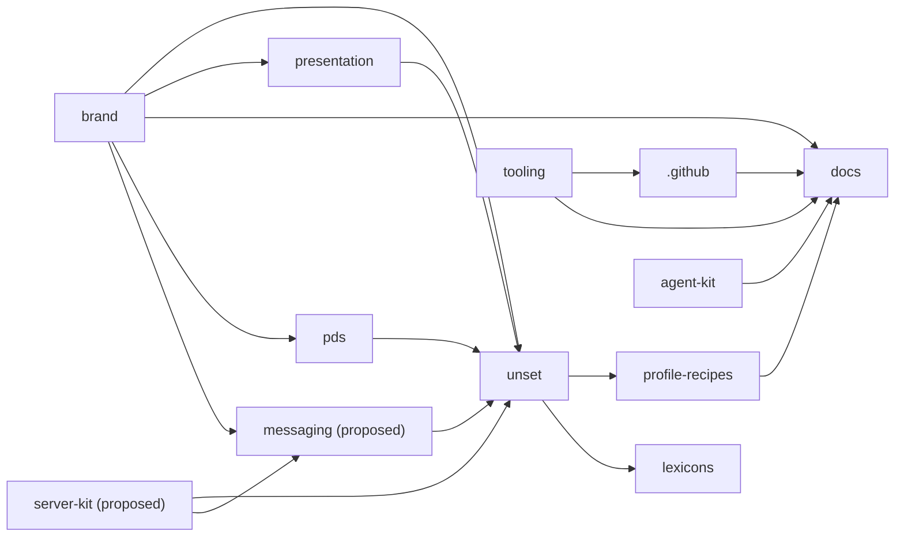

# unset-sh organisation map

<!-- Generated from repos.json by scripts/map.mjs. Edit repos.json, then run npm run map. -->

Which repository owns what, what does not belong in each, and which way the dependencies point. Read this before
starting work in any unset.sh repository, and update [`repos.json`](repos.json) in the same change that creates,
renames, archives or changes the scope of a repository. A daily check compares this map with GitHub and opens an
issue when they differ.

## Repositories

| Repository | Status | What it is |
| --- | --- | --- |
| [`Undefined6799/unset`](https://github.com/Undefined6799/unset) | Active | The unset.sh app: web, admin, public API, indexer, media proxy, their database and deployment. Lives outside the organisation for now and will be largely rewritten, then wired to the repositories below by pinned releases. |
| [`unset-sh/.github`](https://github.com/unset-sh/.github) | Active | The organisation's front page, repository map, community defaults and native starter workflow catalogue. Local map validation stays here, with small pinned read-only callers for shared checks and documentation export from tooling. Consumers retain their own workflow events, permissions and project commands. |
| [`unset-sh/tooling`](https://github.com/unset-sh/tooling) | Active | Maintains shared CI, protected-release and documentation-export implementations, supporting scripts and tests. The initial implementation is merged through pull request #1 at version 0.0.0; the first release and broader consumer adoption remain pending. Consumers retain their own events, permissions, inputs, build and test logic, and immutable caller pins. |
| [`unset-sh/brand`](https://github.com/unset-sh/brand) | Active | The editable visual contract for unset.sh. Ships static CSS, JSON, fonts, mark and icon data as @unset-sh/brand on GitHub Packages, and builds its Hugo guide with an interactive Svelte component gallery for GitHub Pages. |
| [`unset-sh/presentation`](https://github.com/unset-sh/presentation) | Active | Templates and the one rendering path for preview images and embeds, with a gallery of hard cases. Ships @unset-sh/presentation on GitHub Packages; no running service. |
| [`unset-sh/profile-recipes`](https://github.com/unset-sh/profile-recipes) | Active | Persona profile layouts (recipes) with a guide an AI assistant follows to build someone's profile, plus sample records checked against the lexicons. |
| [`unset-sh/docs`](https://github.com/unset-sh/docs) | Active | The live organisation-only docs.unset.sh site: a root Hugo framework edited by pull requests, source-owned repository sections and map views derived from .github. Profile-recipes publishes its section automatically. The old app mirror workflow and its writable credential are retired; the site excludes app documentation until the app moves into the organisation. |
| [`unset-sh/pds`](https://github.com/unset-sh/pds) | Active | The home for unset.sh's PDS image and everything that customises the PDS: the build on top of the official image, the theme for its sign-in and account pages, and their pins. Empty for now; until it moves, the image is built in the app repository (deployment/pds/). |
| [`unset-sh/lexicons`](https://github.com/unset-sh/lexicons) | Active | The public MIT-licensed sh.unset.* lexicon schemas, reference documentation and examples. The initial schemas are an exact snapshot of the merged application source with recorded hashes. Schema changes remain coordinated in the app; synchronization is currently manual and the proposed automatic mirror is not configured. DNS/PDS publication is separate. |
| `unset-sh/messaging` | Proposed, not approved | The private messaging product on unset.cc: one-to-one chat on Matrix today, later communities, channels, roles and voice. Plan drafted, awaiting approval; not created. |
| `unset-sh/server-kit` | Proposed, not approved | Proposed: the generic security code the app and messaging both need (HTTP kit and CSRF gate, egress guard, sealed storage, signed admin envelope, config, log). Not approved yet. |
| [`unset-sh/agent-kit`](https://github.com/unset-sh/agent-kit) | Active | The rules, skills and templates every repository's assistant needs, released as one version and copied into each repository under .claude/, pinned by a lock file. Organisation decision records and AI working notes and artifacts are maintained here; working material stays outside the distributed kit. The shared human documentation standard remains proposed in pull request #7. Updates to distributed rules and skills still require an approved kit release. |

## Which way dependencies point

An arrow reads "feeds": the left side is pinned, copied or pushed into the right. Nothing points back, and the
check fails on a cycle.

- `brand` → `unset`: @unset-sh/brand at an exact version (after the rewrite)
- `presentation` → `unset`: @unset-sh/presentation at an exact version (after the rewrite)
- `messaging` → `unset`: @unset-sh/messaging-contract at an exact version (planned)
- `server-kit` → `unset`: pinned release (if approved)
- `pds` → `unset`: the PDS image by pinned digest (after the move)
- `tooling` → `.github`: small read-only CI and documentation-export callers at a reviewed merged full commit; source checks must pass before export, and automatic update propagation is not configured
- `brand` → `presentation`: @unset-sh/brand at an exact version
- `unset` → `profile-recipes`: lexicon schemas and editor limits, copied at a pinned commit
- `brand` → `docs`: stable published @unset-sh/brand 0.1.x releases, each resolved to an immutable commit; compatible patch updates may rebuild and publish the site automatically after checks
- `.github` → `docs`: repos.json at an exact commit revision for generated organisation map and ownership views; .github remains the source of truth. Its source-owned docs/site/ maps to github/ under the reserved-name exception, with initial import tracked in docs pull request #2
- `agent-kit` → `docs`: planned adoption of org-documentation through the existing sync workflow and lock after an approved kit release; the standard remains proposed in agent-kit pull request #7
- `profile-recipes` → `docs`: source-owned docs/ exported automatically into the profile-recipes/ section with its source revision and licences; publication verified through source 1e64c46 to docs commit 2b4099f
- `tooling` → `docs`: Source-owned docs/ for the tooling/ section with an exact source revision and licences, delivered through reviewed imports; a reviewed full-commit shared refresh runs registered map generators and supplies the public workflow catalogue before site builds. Reusable workflow adoption remains explicit in each consumer
- `brand` → `pds`: theme colours and fonts at an exact version (after the move)
- `unset` → `lexicons`: initial schemas copied from the merged application source at a recorded commit with per-file hashes; synchronization is manual and the proposed automatic mirror is not configured
- `brand` → `messaging`: @unset-sh/brand at an exact version
- `server-kit` → `messaging`: pinned kit packages (if server-kit is approved)

## Licences

Licence is set per repository (Alex, 2026-11-21). Product repositories are AGPL-3.0-only and take no outside code for now. Work meant to be copied stays permissive: the profile-recipes recipes are CC0-1.0 and the lexicon schemas are MIT, and those two take outside work with a DCO sign-off only. Third-party work keeps its own licence. There is no contributor agreement.

Not matching the rule yet (changing a published licence needs the owner's decision):

| Repository | Licence today |
| --- | --- |
| `unset` | AGPL-3.0-only; the lexicon schemas are MIT (as the rule wants); shared/ is MIT under ADR 0012 |
| `pds` | None yet; should be AGPL-3.0-only. The official PDS it builds on keeps its own licence |

## unset

[`Undefined6799/unset`](https://github.com/Undefined6799/unset). Active.

The unset.sh app: web, admin, public API, indexer, media proxy, their database and deployment. Lives outside the organisation for now and will be largely rewritten, then wired to the repositories below by pinned releases.

**Licence:** AGPL-3.0-only; the lexicon schemas are MIT (as the rule wants); shared/ is MIT under ADR 0012.

**Owns**

- Every product rule and screen of unset.sh, and the data behind them
- The sh.unset.* lexicon schemas (shared/lexicons/schemas/), the source of truth until the organisation takes it over
- Deciding what to present: which data, who may see it, URLs, caching and removal
- The app's architecture decision records (docs/human/decisions/)

**Does not belong here**

- Design tokens, fonts, the mark and icons: [`unset-sh/brand`](https://github.com/unset-sh/brand)
- Preview images and embeds drawn from data: [`unset-sh/presentation`](https://github.com/unset-sh/presentation)
- Ready-made profile layouts for AI-assisted setup: [`unset-sh/profile-recipes`](https://github.com/unset-sh/profile-recipes)
- The chat app (unset.cc), once it moves: `unset-sh/messaging`
- The PDS image and its customisation, once they move: [`unset-sh/pds`](https://github.com/unset-sh/pds)

## .github

[`unset-sh/.github`](https://github.com/unset-sh/.github). Active.

The organisation's front page, repository map, community defaults and native starter workflow catalogue. Local map validation stays here, with small pinned read-only callers for shared checks and documentation export from tooling. Consumers retain their own workflow events, permissions and project commands.

**Licence:** AGPL-3.0-only.

**Owns**

- The organisation profile page (profile/README.md)
- This map: repos.json, MAP.md and the daily check that compares them with GitHub
- Organisation community defaults: contribution, conduct, security, support and accessibility policies; public and private report forms and a general pull-request template
- Native starter workflow templates in workflow-templates/, local metadata validation and small callers with explicit events, permissions, inputs and reviewed tooling pins
- Human guidance for organisation defaults and starter templates in docs/site/, plus a pointer to tooling's maintained publishing-key guide; exports use the reserved-name mapping docs:github/, with initial delivery tracked in docs pull request #2

**Does not belong here**

- Code, docs or assets of any product: the repository that owns them, from this map
- Shared CI, release, deployment and documentation-export implementations, supporting scripts and tests: [`unset-sh/tooling`](https://github.com/unset-sh/tooling)
- A consuming repository's build and test commands, event triggers and small workflow callers: the consuming repository; migration to central implementations is pending
- AI working notes and supporting artifacts: [`unset-sh/agent-kit`](https://github.com/unset-sh/agent-kit) under notes/ and artifacts/, outside the distributed kit

## tooling

[`unset-sh/tooling`](https://github.com/unset-sh/tooling). Active.

Maintains shared CI, protected-release and documentation-export implementations, supporting scripts and tests. The initial implementation is merged through pull request #1 at version 0.0.0; the first release and broader consumer adoption remain pending. Consumers retain their own events, permissions, inputs, build and test logic, and immutable caller pins.

**Licence:** AGPL-3.0-only.

**Owns**

- Shared CI, protected-release and documentation-export implementations, supporting scripts and tests; Pages and deployment implementations have not been centralised yet
- Flat reusable entry points directly in .github/workflows/; shared sources under workflows/shared/ and repository-specific sources under workflows/<repository>/ organise the implementation without changing the native GitHub location
- Versioned tooling releases and the implementation of dependency-update proposals; automatic adoption requires explicit update PRs, checks, approvals, eligible auto-merge and downstream delivery, and is not configured yet. Owner release approvals remain required
- Maintained human tooling guides and workflow contracts in docs/ for the docs:tooling/ section; initial delivery is tracked in docs pull request #5
- Read-only public workflow discovery, digest-bound descriptions and immutable reusable-call resolution for the documentation workflow catalogue; shared refresh orchestration for registered map generators

**Does not belong here**

- The organisation profile, repository map, community defaults and native starter workflow templates: [`unset-sh/.github`](https://github.com/unset-sh/.github)
- A consumer's events, permissions, inputs, build and test commands, product code and pinned workflow callers: the consuming repository
- The documentation site framework and publication configuration: [`unset-sh/docs`](https://github.com/unset-sh/docs)
- AI working notes, supporting artifacts, shared assistant rules and organisation decision records: [`unset-sh/agent-kit`](https://github.com/unset-sh/agent-kit)

## brand

[`unset-sh/brand`](https://github.com/unset-sh/brand). Active.

The editable visual contract for unset.sh. Ships static CSS, JSON, fonts, mark and icon data as @unset-sh/brand on GitHub Packages, and builds its Hugo guide with an interactive Svelte component gallery for GitHub Pages.

**Licence:** AGPL-3.0-only project files; OFL-1.1 fonts, reserved Unset mark/app assets, and MIT Tabler/upstream component notices are preserved.

**Owns**

- The editable brand contract: semantic colour, typography, spacing and component style roles
- Generated static package exports, optional Tailwind/shadcn style adapters, fonts, the mark and pinned icon data
- Asset provenance and licences; historical design-sheet provenance is retained
- Brand usage guidelines, the Hugo brand guide and its private interactive Svelte component gallery
- Changeset version preparation, package validation and protected publication, and GitHub Pages guide deployment

**Does not belong here**

- Anything drawn from data, such as link previews and share cards: [`unset-sh/presentation`](https://github.com/unset-sh/presentation)
- Business rules, authentication, network calls and application state: [`Undefined6799/unset`](https://github.com/Undefined6799/unset) or the consuming application
- Component interaction behaviour or consumer deployment orchestration: the consuming application and its shadcn-svelte/Bits UI integration

## presentation

[`unset-sh/presentation`](https://github.com/unset-sh/presentation). Active.

Templates and the one rendering path for preview images and embeds, with a gallery of hard cases. Ships @unset-sh/presentation on GitHub Packages; no running service.

**Licence:** AGPL-3.0-only; third-party dependencies retain their own licences.

**Owns**

- Templates for profile, post and article previews, one owner per template
- Rendering supplied data into images and embeds
- The gallery of hard cases each template must survive

**Does not belong here**

- Deciding what to show: data, visibility, URLs, caching, removal: [`Undefined6799/unset`](https://github.com/Undefined6799/unset)
- Colours, fonts and the mark: [`unset-sh/brand`](https://github.com/unset-sh/brand)
- A server or a queue that renders on request: [`Undefined6799/unset`](https://github.com/Undefined6799/unset) (it calls this package)

## profile-recipes

[`unset-sh/profile-recipes`](https://github.com/unset-sh/profile-recipes). Active.

Persona profile layouts (recipes) with a guide an AI assistant follows to build someone's profile, plus sample records checked against the lexicons.

**Licence:** Tooling AGPL-3.0-only; recipes CC0-1.0; copied schemas retain their upstream MIT notice and local fonts retain their SIL Open Font Licences.

**Owns**

- Recipes: recipe.json, GUIDE.md, sample records, assets and preview per persona
- AGENTS.md: the rules an assistant follows when applying a recipe
- The validator that checks recipes against a vendored lexicon snapshot and editor limits
- Human documentation in docs/ and its source-owned export into docs:profile-recipes/; automated publication verified through source 1e64c46 to docs commit 2b4099f

**Does not belong here**

- The lexicon schemas themselves (schemas/upstream/ here is a copy): [`Undefined6799/unset`](https://github.com/Undefined6799/unset)
- The profile editor and its limits (limits.json here is a mirror): [`Undefined6799/unset`](https://github.com/Undefined6799/unset)
- The documentation site's root configuration, navigation and layouts: [`unset-sh/docs`](https://github.com/unset-sh/docs)
- Shared CI, release, deployment and documentation-export implementations, supporting scripts and tests: [`unset-sh/tooling`](https://github.com/unset-sh/tooling)
- Organisation community defaults and native starter workflow templates: [`unset-sh/.github`](https://github.com/unset-sh/.github)

## docs

[`unset-sh/docs`](https://github.com/unset-sh/docs). Active.

The live organisation-only docs.unset.sh site: a root Hugo framework edited by pull requests, source-owned repository sections and map views derived from .github. Profile-recipes publishes its section automatically. The old app mirror workflow and its writable credential are retired; the site excludes app documentation until the app moves into the organisation.

**Licence:** AGPL-3.0-only root framework; mirrored source documentation and third-party assets retain their own licences.

**Owns**

- The root Hugo configuration, theme integration, layouts, navigation, front page and publication framework, changed by pull request
- Source-derived organisation map and ownership views from an exact .github revision
- Map-specific validation, accessible organisation and workflow views, and a map registry whose generators run through the pinned shared refresh during site publication; workflow collection and shared orchestration are implemented in tooling
- One top folder per participating unset-sh repository; mirrored pages, examples and diagrams remain source-owned and are replaced only by that repository's docs job
- The site build commands, checks and GitHub Pages publication for docs.unset.sh; migration to central workflow implementations and reviewed callers is pending

**Does not belong here**

- Authoring or hand-editing a source repository's mirrored documentation: the source repository's docs folder
- Hand-maintaining repository ownership descriptions: [`unset-sh/.github`](https://github.com/unset-sh/.github) repos.json
- Shared visual values, assets and the brand contract: [`unset-sh/brand`](https://github.com/unset-sh/brand)
- The shared human documentation standard and authoring templates: [`unset-sh/agent-kit`](https://github.com/unset-sh/agent-kit) (proposed in pull request #7; not released yet)
- AI working notes and supporting artifacts: [`unset-sh/agent-kit`](https://github.com/unset-sh/agent-kit) under notes/ and artifacts/, outside the distributed kit
- Shared CI, release, deployment and documentation-export implementations, supporting scripts and tests: [`unset-sh/tooling`](https://github.com/unset-sh/tooling)
- Organisation community defaults and native starter workflow templates: [`unset-sh/.github`](https://github.com/unset-sh/.github)
- Application documentation from outside the unset-sh organisation: its source repository; the app is only context in the organisation map

## pds

[`unset-sh/pds`](https://github.com/unset-sh/pds). Active.

The home for unset.sh's PDS image and everything that customises the PDS: the build on top of the official image, the theme for its sign-in and account pages, and their pins. Empty for now; until it moves, the image is built in the app repository (deployment/pds/).

**Licence:** None yet; should be AGPL-3.0-only. The official PDS it builds on keeps its own licence.

**Owns**

- The first-party PDS image: built on the official bluesky-social/pds image, with its upstream source and package versions pinned
- Customising the PDS: the theme for its sign-in and account pages, and any other change to the stock PDS

**Does not belong here**

- Running and deploying the PDS, and the process that holds its admin password (pds-admin): [`Undefined6799/unset`](https://github.com/Undefined6799/unset)
- Colours, fonts and the mark the theme uses: [`unset-sh/brand`](https://github.com/unset-sh/brand)

## lexicons

[`unset-sh/lexicons`](https://github.com/unset-sh/lexicons). Active.

The public MIT-licensed sh.unset.* lexicon schemas, reference documentation and examples. The initial schemas are an exact snapshot of the merged application source with recorded hashes. Schema changes remain coordinated in the app; synchronization is currently manual and the proposed automatic mirror is not configured. DNS/PDS publication is separate.

**Licence:** MIT schemas and documentation.

**Owns**

- The published copy of the sh.unset.* schemas, their docs and examples

**Does not belong here**

- Any edit to a schema: [`Undefined6799/unset`](https://github.com/Undefined6799/unset) (shared/lexicons/schemas/); coordinate changes there and refresh the recorded snapshot manually

## messaging

`unset-sh/messaging`. Proposed, not approved.

The private messaging product on unset.cc: one-to-one chat on Matrix today, later communities, channels, roles and voice. Plan drafted, awaiting approval; not created.

**Licence:** Not created; AGPL-3.0-only.

**Owns**

- The chat client and the door (the public process on unset.cc)
- The admin service that alone holds the MAS credential
- Messaging rules, the Matrix adapter and the Synapse policy module
- The Synapse image and the reviewed Synapse and MAS configs
- Its own database tables
- @unset-sh/messaging-contract: the only thing the app pins

**Does not belong here**

- Identity and sign-in: [`Undefined6799/unset`](https://github.com/Undefined6799/unset)
- Generic server code (HTTP kit, CSRF gate, egress guard, sealing): `unset-sh/server-kit`
- Design tokens, fonts and icons: [`unset-sh/brand`](https://github.com/unset-sh/brand)
- Deploying the whole stack: [`Undefined6799/unset`](https://github.com/Undefined6799/unset) (until a deploy repository is decided)

## server-kit

`unset-sh/server-kit`. Proposed, not approved.

Proposed: the generic security code the app and messaging both need (HTTP kit and CSRF gate, egress guard, sealed storage, signed admin envelope, config, log). Not approved yet.

**Licence:** Not created; AGPL-3.0-only for the whole kit.

**Owns**

- Generic server code with no product meaning

**Does not belong here**

- Anything with product meaning: [`Undefined6799/unset`](https://github.com/Undefined6799/unset) or messaging

## agent-kit

[`unset-sh/agent-kit`](https://github.com/unset-sh/agent-kit). Active.

The rules, skills and templates every repository's assistant needs, released as one version and copied into each repository under .claude/, pinned by a lock file. Organisation decision records and AI working notes and artifacts are maintained here; working material stays outside the distributed kit. The shared human documentation standard remains proposed in pull request #7. Updates to distributed rules and skills still require an approved kit release.

**Licence:** AGPL-3.0-only.

**Owns**

- Organisation-wide assistant rules and the three generic engineering documents
- The shared human documentation standard, architecture guidance and authoring templates as org-documentation, proposed in pull request #7
- Organisation decision records, including the accepted tooling and documentation ownership decisions
- AI working notes in notes/ and supporting artifacts in artifacts/, grouped by task and excluded from the distributed kit
- The CLAUDE.md and AGENTS.md templates
- Shared skills and subagents, the model and effort router text, and the sync script
- Requester/provider procedures for missing brand resources, with requests tracked as brand issues; AGENTS.md entry-point templates route agents to the shared rules and skills

**Does not belong here**

- A repository's own rules: that repository's CLAUDE.md
- The organisation map: [`unset-sh/.github`](https://github.com/unset-sh/.github)
- A repository's own architecture decision records: the repository that owns the decision
- Another repository's maintained human documentation: the source repository's docs/; exported to docs for publication
- Shared CI, release, deployment and documentation-export implementations, supporting scripts and tests: [`unset-sh/tooling`](https://github.com/unset-sh/tooling)
- Organisation community defaults and native starter workflow templates: [`unset-sh/.github`](https://github.com/unset-sh/.github)

