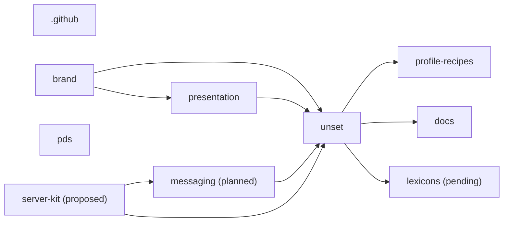

# unset-sh organisation map

<!-- Generated from repos.json by scripts/map.mjs. Edit repos.json, then run npm run map. -->

Which repository owns what, what does not belong in each, and which way the dependencies point. Read this before
starting work in any unset.sh repository, and update [`repos.json`](repos.json) in the same change that creates,
renames, archives or changes the scope of a repository. A daily check compares this map with GitHub and opens an
issue when they differ.

## Repositories

| Repository | Status | What it is |
| --- | --- | --- |
| [`Undefined6799/unset`](https://github.com/Undefined6799/unset) | Active | The unset.sh app: web, admin, public API, indexer, media proxy, their database and deployment. Lives outside the organisation for now and will be largely rewritten, then wired to the repositories below by pinned releases. |
| [`unset-sh/.github`](https://github.com/unset-sh/.github) | Active | The organisation's front page and this map. |
| [`unset-sh/brand`](https://github.com/unset-sh/brand) | Active | Fixed files that say what unset.sh looks like, as pinned copies of the design sheet. Ships the package @unset-sh/brand (data only) on GitHub Packages. |
| [`unset-sh/presentation`](https://github.com/unset-sh/presentation) | Active | Templates and the one rendering path for preview images and embeds, with a gallery of hard cases. Ships @unset-sh/presentation on GitHub Packages; no running service. |
| [`unset-sh/profile-recipes`](https://github.com/unset-sh/profile-recipes) | Active | Persona profile layouts (recipes) with a guide an AI assistant follows to build someone's profile, plus sample records checked against the lexicons. |
| [`unset-sh/docs`](https://github.com/unset-sh/docs) | Active | Every repository's human docs, aggregated, and the docs.unset.sh site built from them on GitHub Pages. Nothing here is written by hand: each source repository's CI pushes its own top folder. Waiting for its first push. |
| [`unset-sh/pds`](https://github.com/unset-sh/pds) | Active | Purpose not recorded yet. The repository has been empty since 2026-10-17. |
| `unset-sh/lexicons` | Approved, waiting for setup | A one-way, read-only copy of the sh.unset.* lexicon schemas, pushed by the app's mirror job. Waiting for setup by the owner; the direction reverses later, when the organisation becomes the source of truth. |
| `unset-sh/messaging` | Planned, not created | The chat app on unset.cc, moving out of the app repository; will grow into a community app with channels, roles and voice. Plan drafted, not created yet. |
| `unset-sh/server-kit` | Proposed, not approved | Proposed: the generic security code the app and messaging both need (HTTP kit and CSRF gate, egress guard, sealed storage, signed admin envelope, config, log). Not approved yet. |

## Which way dependencies point

An arrow reads "feeds": the left side is pinned, copied or pushed into the right. Nothing points back, and the
check fails on a cycle.

- `brand` → `unset`: @unset-sh/brand at an exact version (after the rewrite)
- `presentation` → `unset`: @unset-sh/presentation at an exact version (after the rewrite)
- `messaging` → `unset`: @unset-sh/messaging-contract at an exact version (planned)
- `server-kit` → `unset`: pinned release (if approved)
- `brand` → `presentation`: @unset-sh/brand at an exact version
- `unset` → `profile-recipes`: lexicon schemas and editor limits, copied at a pinned commit
- `unset` → `docs`: pushes docs/human and docs/site into unset/ with its own deploy key
- `unset` → `lexicons`: pushes the schemas with its own deploy key
- `server-kit` → `messaging`: pinned release (if server-kit is approved)

## unset

[`Undefined6799/unset`](https://github.com/Undefined6799/unset). Active.

The unset.sh app: web, admin, public API, indexer, media proxy, their database and deployment. Lives outside the organisation for now and will be largely rewritten, then wired to the repositories below by pinned releases.

**Owns**

- Every product rule and screen of unset.sh, and the data behind them
- The sh.unset.* lexicon schemas (shared/lexicons/schemas/), the source of truth until the organisation takes it over
- Deciding what to present: which data, who may see it, URLs, caching and removal
- The app's architecture decision records (docs/human/decisions/)

**Does not belong here**

- Design tokens, fonts, the mark and icons: [`unset-sh/brand`](https://github.com/unset-sh/brand)
- Preview images and embeds drawn from data: [`unset-sh/presentation`](https://github.com/unset-sh/presentation)
- Ready-made profile layouts for AI-assisted setup: [`unset-sh/profile-recipes`](https://github.com/unset-sh/profile-recipes)
- The chat app (unset.cc), once it moves: `unset-sh/messaging`

## .github

[`unset-sh/.github`](https://github.com/unset-sh/.github). Active.

The organisation's front page and this map.

**Owns**

- The organisation profile page (profile/README.md)
- This map: repos.json, MAP.md and the daily check that compares them with GitHub
- Community health files shared by every repository, when they are added

**Does not belong here**

- Code, docs or assets of any product: the repository that owns them, from this map

## brand

[`unset-sh/brand`](https://github.com/unset-sh/brand). Active.

Fixed files that say what unset.sh looks like, as pinned copies of the design sheet. Ships the package @unset-sh/brand (data only) on GitHub Packages.

**Owns**

- Design tokens (colour, type, spacing), the two fonts, the mark and icons
- Brand guidelines: how to use colour, type and the mark
- source.json: the design sheet version and sha256 of every copied file

**Does not belong here**

- Anything drawn from data, such as link previews and share cards: [`unset-sh/presentation`](https://github.com/unset-sh/presentation)
- Code that decides or serves anything: [`Undefined6799/unset`](https://github.com/Undefined6799/unset)
- A file that is not in the design sheet yet: the design sheet first

## presentation

[`unset-sh/presentation`](https://github.com/unset-sh/presentation). Active.

Templates and the one rendering path for preview images and embeds, with a gallery of hard cases. Ships @unset-sh/presentation on GitHub Packages; no running service.

**Owns**

- Templates for profile, post and article previews, one owner per template
- Rendering supplied data into images and embeds
- The gallery of hard cases each template must survive

**Does not belong here**

- Deciding what to show: data, visibility, URLs, caching, removal: [`Undefined6799/unset`](https://github.com/Undefined6799/unset)
- Colours, fonts and the mark: [`unset-sh/brand`](https://github.com/unset-sh/brand)
- A server or a queue that renders on request: [`Undefined6799/unset`](https://github.com/Undefined6799/unset) (it calls this package)

## profile-recipes

[`unset-sh/profile-recipes`](https://github.com/unset-sh/profile-recipes). Active.

Persona profile layouts (recipes) with a guide an AI assistant follows to build someone's profile, plus sample records checked against the lexicons.

**Owns**

- Recipes: recipe.json, GUIDE.md, sample records, assets and preview per persona
- AGENTS.md: the rules an assistant follows when applying a recipe
- The validator that checks recipes against a vendored lexicon snapshot and editor limits

**Does not belong here**

- The lexicon schemas themselves (lexicons/ here is a copy): [`Undefined6799/unset`](https://github.com/Undefined6799/unset)
- The profile editor and its limits (limits.json here is a mirror): [`Undefined6799/unset`](https://github.com/Undefined6799/unset)

## docs

[`unset-sh/docs`](https://github.com/unset-sh/docs). Active.

Every repository's human docs, aggregated, and the docs.unset.sh site built from them on GitHub Pages. Nothing here is written by hand: each source repository's CI pushes its own top folder. Waiting for its first push.

**Owns**

- One top folder per source repository, replaced only by that repository's docs job
- The site build and GitHub Pages deploy for docs.unset.sh

**Does not belong here**

- Writing or editing docs: the source repository's docs folder

## pds

[`unset-sh/pds`](https://github.com/unset-sh/pds). Active.

Purpose not recorded yet. The repository has been empty since 2026-10-17.

## lexicons

`unset-sh/lexicons`. Approved, waiting for setup.

A one-way, read-only copy of the sh.unset.* lexicon schemas, pushed by the app's mirror job. Waiting for setup by the owner; the direction reverses later, when the organisation becomes the source of truth.

**Owns**

- The published copy of the sh.unset.* schemas, their docs and examples

**Does not belong here**

- Any edit to a schema: [`Undefined6799/unset`](https://github.com/Undefined6799/unset) (shared/lexicons/schemas/); the mirror copies it here

## messaging

`unset-sh/messaging`. Planned, not created.

The chat app on unset.cc, moving out of the app repository; will grow into a community app with channels, roles and voice. Plan drafted, not created yet.

**Owns**

- The chat client, its door and admin process, the Matrix adapter, its own tables and deployment
- @unset-sh/messaging-contract: the only thing the app pins

**Does not belong here**

- Identity, profiles and sign-in: [`Undefined6799/unset`](https://github.com/Undefined6799/unset)
- Generic security code (HTTP kit, CSRF gate, egress guard, sealing): `unset-sh/server-kit`

## server-kit

`unset-sh/server-kit`. Proposed, not approved.

Proposed: the generic security code the app and messaging both need (HTTP kit and CSRF gate, egress guard, sealed storage, signed admin envelope, config, log). Not approved yet.

**Owns**

- Generic server code with no product meaning

**Does not belong here**

- Anything with product meaning: [`Undefined6799/unset`](https://github.com/Undefined6799/unset) or messaging
