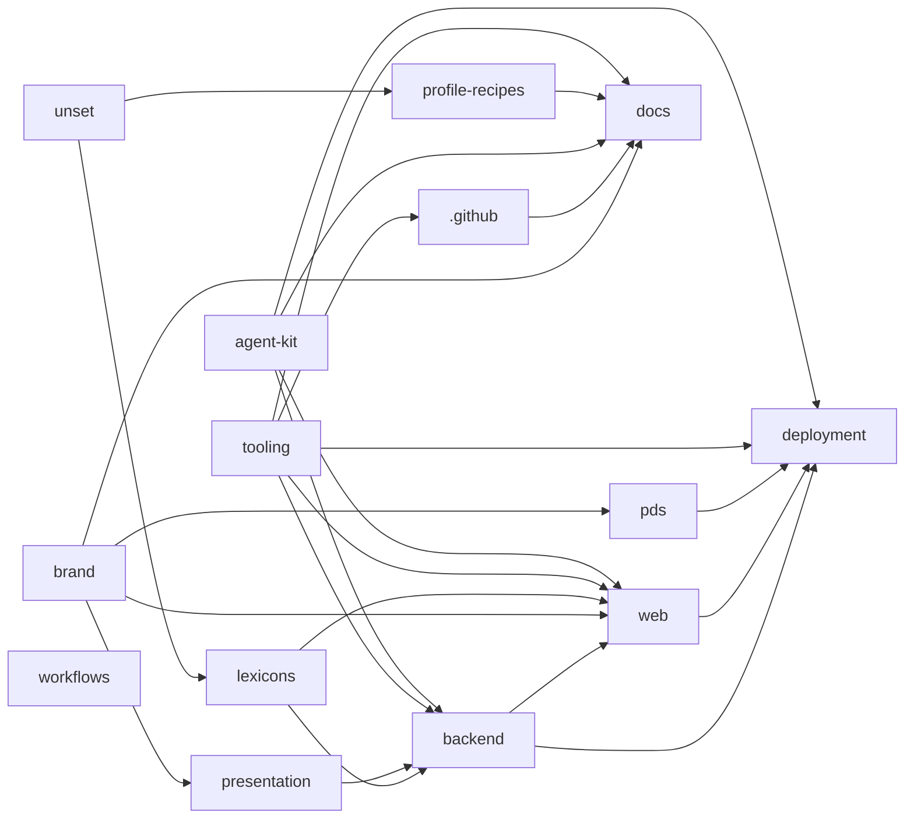

# unset-sh organisation map

<!-- Generated from repos.json by scripts/map.mjs. Edit repos.json, then run npm run map. -->

Which repository owns what, what does not belong in each, and which way the dependencies point. Read this before
starting work in any unset.sh repository, and update [`repos.json`](repos.json) in the same change that creates,
renames, archives or changes the scope of a repository. A daily check compares this map with GitHub and opens an
issue when they differ.

## Repositories

| Repository | Status | What it is |
| --- | --- | --- |
| [`unset-sh/web`](https://github.com/unset-sh/web) | Active | The approved home for the complete web application, including messaging UI and web/device adapters. The repository exists with an initial README and licence; detailed ownership setup is under review. No runnable SvelteKit application, image or migrated feature exists yet. |
| [`unset-sh/backend`](https://github.com/unset-sh/backend) | Active | The approved product backend shared by web and future mobile clients. The repository exists with an initial README and licence; detailed ownership setup is under review. Application code, API contracts, images and migration remain pending. Replaces the proposed server-kit destination; messaging is a capability here, not a standalone repository. |
| [`unset-sh/deployment`](https://github.com/unset-sh/deployment) | Active | The approved home for environment definitions and stack release assembly. The repository exists with an initial README and licence; detailed ownership setup is under review. No deployable stack, image selections, infrastructure configuration or rollout automation exists yet. |
| [`Undefined6799/unset`](https://github.com/Undefined6799/unset) | Active | The existing application outside the organisation, retained read-only during the migration. Its implementation and regression evidence inform the new web, backend and deployment repositories; their creation does not mean the application has moved. |
| [`unset-sh/.github`](https://github.com/unset-sh/.github) | Active | The organisation's front page, repository map, community defaults and native starter workflow catalogue. Local map validation stays here, with small pinned read-only callers for shared checks and documentation export from tooling. Consumers retain their own workflow events, permissions and project commands. |
| [`unset-sh/tooling`](https://github.com/unset-sh/tooling) | Active | Maintains shared CI, protected-release and documentation-export implementations, supporting scripts and tests. The initial implementation is merged through pull request #1 at version 0.0.0; the first release and broader consumer adoption remain pending. Consumers retain their own events, permissions, inputs, build and test logic, and immutable caller pins. |
| [`unset-sh/brand`](https://github.com/unset-sh/brand) | Active | The editable visual contract for unset.sh. Ships static CSS, JSON, fonts, mark and icon data as @unset-sh/brand on GitHub Packages, and builds its Hugo guide with an interactive Svelte component gallery for GitHub Pages. |
| [`unset-sh/presentation`](https://github.com/unset-sh/presentation) | Active | Templates and the one rendering path for preview images and embeds, with a gallery of hard cases. Ships @unset-sh/presentation on GitHub Packages; no running service. |
| [`unset-sh/profile-recipes`](https://github.com/unset-sh/profile-recipes) | Active | Persona profile layouts (recipes) with a guide an AI assistant follows to build someone's profile, plus sample records checked against the lexicons. |
| [`unset-sh/docs`](https://github.com/unset-sh/docs) | Active | The live organisation-only docs.unset.sh site: a root Hugo framework edited by pull requests, source-owned repository sections and map views derived from .github. Profile-recipes publishes its section automatically. The old app mirror workflow and its writable credential are retired; the site excludes app documentation until the app moves into the organisation. |
| [`unset-sh/pds`](https://github.com/unset-sh/pds) | Active | The home for unset.sh's PDS image and everything that customises the PDS: the build on top of the official image, the theme for its sign-in and account pages, and their pins. Empty for now; until it moves, the image is built in the app repository (deployment/pds/). |
| [`unset-sh/lexicons`](https://github.com/unset-sh/lexicons) | Active | The public MIT-licensed sh.unset.* schemas, reference documentation and examples, and the agreed destination for protocol authority. Current schema bytes retain their exact application-import provenance; the maintained import/authoring policy and consumer adoption still need the authority cutover. GitHub source, generated SDKs and DNS/PDS publication are separate states. |
| [`unset-sh/agent-kit`](https://github.com/unset-sh/agent-kit) | Active | The rules, skills and templates every repository's assistant needs, released as one version and copied into each repository under .claude/, pinned by a lock file. Organisation decision records and AI working notes and artifacts are maintained here; working material stays outside the distributed kit. The shared human documentation standard remains proposed in pull request #7. Updates to distributed rules and skills still require an approved kit release. |
| [`unset-sh/workflows`](https://github.com/unset-sh/workflows) | Archived | Archived after the earlier decision to consolidate organisation automation in .github. Main contains only a README, with the original check and release proposal retained in pull request #1. The later ownership decision assigns shared implementations to tooling, whose foundation is merged; the first tooling release and broader consumer adoption remain pending. |

## Which way dependencies point

An arrow reads "feeds": the left side is pinned, copied or pushed into the right. Nothing points back, and the
check fails on a cycle.

- `backend` → `web`: planned public API consumption; browser and SSR code do not import private backend implementations
- `brand` → `web`: planned semantic tokens and assets through immutable consumer artifacts
- `lexicons` → `web`: planned supported protocol artifacts where the client needs them
- `tooling` → `web`: planned reviewed workflow callers with product-owned checks
- `agent-kit` → `web`: bootstrap instructions reference a recorded full commit; installed kit and release adoption remain pending
- `lexicons` → `backend`: planned protocol artifact consumption at reviewed immutable revisions after authority and compatibility cutover
- `presentation` → `backend`: planned rendering from authorized supplied data; no package is installed yet
- `tooling` → `backend`: planned reviewed workflow callers once meaningful product checks and builds exist
- `agent-kit` → `backend`: bootstrap instructions reference a recorded full commit; installed kit and release adoption remain pending
- `backend` → `deployment`: planned deployment of released API, indexer and other independently privileged backend images
- `web` → `deployment`: planned deployment of the released web image
- `pds` → `deployment`: planned deployment of a maintained PDS image by verified digest
- `tooling` → `deployment`: planned shared deployment mechanisms; current tooling does not implement stack deployment
- `agent-kit` → `deployment`: bootstrap instructions reference a recorded full commit; installed kit and release adoption remain pending
- `tooling` → `.github`: small read-only CI and documentation-export callers at a reviewed merged full commit; source checks must pass before export, and automatic update propagation is not configured
- `brand` → `presentation`: @unset-sh/brand at an exact version
- `unset` → `profile-recipes`: lexicon schemas and editor limits, copied at a pinned commit
- `brand` → `docs`: stable published @unset-sh/brand 0.1.x releases, each resolved to an immutable commit; compatible patch updates may rebuild and publish the site automatically after checks
- `.github` → `docs`: repos.json at an exact commit revision for generated organisation map and ownership views; .github remains the source of truth. Its source-owned docs/site/ maps to github/ under the reserved-name exception, with initial import tracked in docs pull request #2
- `agent-kit` → `docs`: planned adoption of org-documentation through the existing sync workflow and lock after an approved kit release; the standard remains proposed in agent-kit pull request #7
- `profile-recipes` → `docs`: source-owned docs/ exported automatically into the profile-recipes/ section with its source revision and licences; publication verified through source 1e64c46 to docs commit 2b4099f
- `tooling` → `docs`: source-owned docs/site/ for the tooling/ section with an exact source revision and licences, delivered through reviewed imports; initial import is tracked in docs pull request #5. Adoption of shared workflow implementations remains separate
- `brand` → `pds`: theme colours and fonts at an exact version (after the move)
- `unset` → `lexicons`: initial schemas copied from the merged application source at a recorded commit with per-file hashes; synchronization is manual and the proposed automatic mirror is not configured

## Licences

Licence is set per repository (Alex, 2026-11-21). Product repositories are AGPL-3.0-only and take no outside code for now. Work meant to be copied stays permissive: the profile-recipes recipes are CC0-1.0 and the lexicon schemas are MIT, and those two take outside work with a DCO sign-off only. Third-party work keeps its own licence. There is no contributor agreement.

Not matching the rule yet (changing a published licence needs the owner's decision):

| Repository | Licence today |
| --- | --- |
| `unset` | AGPL-3.0-only; the lexicon schemas are MIT (as the rule wants); shared/ is MIT under ADR 0012 |
| `pds` | None yet; should be AGPL-3.0-only. The official PDS it builds on keeps its own licence |
| `workflows` | No licence detected on archived main; the unpublished implementation in pull request #1 proposed AGPL-3.0-only |

## web

[`unset-sh/web`](https://github.com/unset-sh/web). Active.

The approved home for the complete web application, including messaging UI and web/device adapters. The repository exists with an initial README and licence; detailed ownership setup is under review. No runnable SvelteKit application, image or migrated feature exists yet.

**Licence:** AGPL-3.0-only first-party work; foundation only, no application code imported.

**Owns**

- SvelteKit routes, SSR, screens, interactions, web sessions and web-specific response handling
- Client capability interfaces and adapters, including messaging device responsibilities where required
- Web tests, browser/server boundaries and producer image builds

**Does not belong here**

- Authoritative product operations and private data adapters: [`unset-sh/backend`](https://github.com/unset-sh/backend)
- Shared brand tokens and assets: [`unset-sh/brand`](https://github.com/unset-sh/brand)
- Canonical protocol definitions: [`unset-sh/lexicons`](https://github.com/unset-sh/lexicons)
- Environment wiring and stack delivery: [`unset-sh/deployment`](https://github.com/unset-sh/deployment)

## backend

[`unset-sh/backend`](https://github.com/unset-sh/backend). Active.

The approved product backend shared by web and future mobile clients. The repository exists with an initial README and licence; detailed ownership setup is under review. Application code, API contracts, images and migration remain pending. Replaces the proposed server-kit destination; messaging is a capability here, not a standalone repository.

**Licence:** AGPL-3.0-only first-party work; foundation only, no application code imported.

**Owns**

- Product domains and operations, authoritative authorization, and private domain-owned contracts
- Published service APIs and consumer compatibility checks, distinct from private domain ports
- AppView query APIs, indexing rules and feature projections; separate privileged process entry points
- Technology-specific server adapters, including AT Protocol, Postgres and S3; domain code depends on capability contracts
- Database migration definitions, image builds and runtime configuration contracts

**Does not belong here**

- Web and messaging screens, browser sessions and device-side integrations: [`unset-sh/web`](https://github.com/unset-sh/web)
- Environment topology, bucket provisioning, selected images and stack rollout: [`unset-sh/deployment`](https://github.com/unset-sh/deployment)
- PDS image packaging and customization: [`unset-sh/pds`](https://github.com/unset-sh/pds)
- Canonical shared protocol definitions: [`unset-sh/lexicons`](https://github.com/unset-sh/lexicons)
- Shared developer-tooling implementations: [`unset-sh/tooling`](https://github.com/unset-sh/tooling)

## deployment

[`unset-sh/deployment`](https://github.com/unset-sh/deployment). Active.

The approved home for environment definitions and stack release assembly. The repository exists with an initial README and licence; detailed ownership setup is under review. No deployable stack, image selections, infrastructure configuration or rollout automation exists yet.

**Licence:** AGPL-3.0-only first-party work; foundation only, no application code imported.

**Owns**

- Environment topology, networks, volumes, bucket provisioning, configuration references and access policies
- A versioned compatible set of producer-built immutable images and artifacts, not one combined services image
- Rollout order, health verification, recorded deployed versions and recovery procedures
- Execution of producer-owned migration contracts and separately operated services such as PDS and Tap when adopted

**Does not belong here**

- Application code, AppView/indexer behavior and database migration definitions: [`unset-sh/backend`](https://github.com/unset-sh/backend)
- Web code and web image builds: [`unset-sh/web`](https://github.com/unset-sh/web)
- Maintained PDS image builds and customization: [`unset-sh/pds`](https://github.com/unset-sh/pds)
- Reusable CI and deployment execution mechanisms: [`unset-sh/tooling`](https://github.com/unset-sh/tooling)

## unset

[`Undefined6799/unset`](https://github.com/Undefined6799/unset). Active.

The existing application outside the organisation, retained read-only during the migration. Its implementation and regression evidence inform the new web, backend and deployment repositories; their creation does not mean the application has moved.

**Licence:** AGPL-3.0-only; the lexicon schemas are MIT (as the rule wants); shared/ is MIT under ADR 0012.

**Owns**

- The current application implementation and its tests until each destination migration is verified
- Historical application decisions and recorded schema-import provenance
- Existing runtime behavior; no production cutover is implied by the organisation layout

**Does not belong here**

- New organisation web UI, routes and web-specific adapters: [`unset-sh/web`](https://github.com/unset-sh/web)
- New organisation product operations, AppView and server adapters: [`unset-sh/backend`](https://github.com/unset-sh/backend)
- New environment topology and stack release assembly: [`unset-sh/deployment`](https://github.com/unset-sh/deployment)
- Canonical shared brand and rendering capabilities: [`unset-sh/brand`](https://github.com/unset-sh/brand) and presentation
- Organisation architecture decisions and this migration record: [`unset-sh/agent-kit`](https://github.com/unset-sh/agent-kit)

## .github

[`unset-sh/.github`](https://github.com/unset-sh/.github). Active.

The organisation's front page, repository map, community defaults and native starter workflow catalogue. Local map validation stays here, with small pinned read-only callers for shared checks and documentation export from tooling. Consumers retain their own workflow events, permissions and project commands.

**Licence:** AGPL-3.0-only.

**Owns**

- The organisation profile page (profile/README.md)
- This map: repos.json, MAP.md and the daily check that compares them with GitHub
- Organisation community defaults: contribution, conduct, security, support and accessibility policies; public and private report forms and a general pull-request template
- Native starter workflow templates in workflow-templates/, local metadata validation and small callers with explicit events, permissions, inputs and reviewed tooling pins
- Human guidance for organisation defaults and starter templates in docs/site/, plus a pointer to tooling's maintained publishing-key guide; exports use the reserved-name mapping docs:github/, with initial delivery tracked in docs pull request #2

**Does not belong here**

- Code, docs or assets of any product: the repository that owns them, from this map
- Shared CI, release, deployment and documentation-export implementations, supporting scripts and tests: [`unset-sh/tooling`](https://github.com/unset-sh/tooling)
- A consuming repository's build and test commands, event triggers and small workflow callers: the consuming repository; migration to central implementations is pending
- AI working notes and supporting artifacts: [`unset-sh/agent-kit`](https://github.com/unset-sh/agent-kit) under notes/ and artifacts/, outside the distributed kit

## tooling

[`unset-sh/tooling`](https://github.com/unset-sh/tooling). Active.

Maintains shared CI, protected-release and documentation-export implementations, supporting scripts and tests. The initial implementation is merged through pull request #1 at version 0.0.0; the first release and broader consumer adoption remain pending. Consumers retain their own events, permissions, inputs, build and test logic, and immutable caller pins.

**Licence:** AGPL-3.0-only.

**Owns**

- Shared CI, protected-release and documentation-export implementations, supporting scripts and tests; Pages and deployment implementations have not been centralised yet
- Flat reusable entry points directly in .github/workflows/; category source folders and generation may organise the implementation without changing the native GitHub location
- Versioned tooling releases and the implementation of dependency-update proposals; automatic adoption requires explicit update PRs, checks, approvals, eligible auto-merge and downstream delivery, and is not configured yet. Owner release approvals remain required
- Maintained human tooling guides and workflow contracts in docs/site/ for the docs:tooling/ section; initial delivery is tracked in docs pull request #5

**Does not belong here**

- The organisation profile, repository map, community defaults and native starter workflow templates: [`unset-sh/.github`](https://github.com/unset-sh/.github)
- A consumer's events, permissions, inputs, build and test commands, product code and pinned workflow callers: the consuming repository
- The documentation site framework and publication configuration: [`unset-sh/docs`](https://github.com/unset-sh/docs)
- AI working notes, supporting artifacts, shared assistant rules and organisation decision records: [`unset-sh/agent-kit`](https://github.com/unset-sh/agent-kit)

## brand

[`unset-sh/brand`](https://github.com/unset-sh/brand). Active.

The editable visual contract for unset.sh. Ships static CSS, JSON, fonts, mark and icon data as @unset-sh/brand on GitHub Packages, and builds its Hugo guide with an interactive Svelte component gallery for GitHub Pages.

**Licence:** AGPL-3.0-only project files; OFL-1.1 fonts, reserved Unset mark/app assets, and MIT Tabler/upstream component notices are preserved.

**Owns**

- The editable brand contract: semantic colour, typography, spacing and component style roles
- Generated static package exports, optional Tailwind/shadcn style adapters, fonts, the mark and pinned icon data
- Asset provenance and licences; historical design-sheet provenance is retained
- Brand usage guidelines, the Hugo brand guide and its private interactive Svelte component gallery
- Changeset version preparation, package validation and protected publication, and GitHub Pages guide deployment

**Does not belong here**

- Anything drawn from data, such as link previews and share cards: [`unset-sh/presentation`](https://github.com/unset-sh/presentation)
- Business rules, authentication, network calls and application state: [`unset-sh/backend`](https://github.com/unset-sh/backend) or web, according to the capability
- Component interaction behaviour or consumer deployment orchestration: the consuming application and its shadcn-svelte/Bits UI integration

## presentation

[`unset-sh/presentation`](https://github.com/unset-sh/presentation). Active.

Templates and the one rendering path for preview images and embeds, with a gallery of hard cases. Ships @unset-sh/presentation on GitHub Packages; no running service.

**Licence:** AGPL-3.0-only; third-party dependencies retain their own licences.

**Owns**

- Templates for profile, post and article previews, one owner per template
- Rendering supplied data into images and embeds
- The gallery of hard cases each template must survive

**Does not belong here**

- Deciding what to show: data, visibility, URLs, caching, removal: [`unset-sh/backend`](https://github.com/unset-sh/backend) (after the application migration; currently the read-only source app)
- Colours, fonts and the mark: [`unset-sh/brand`](https://github.com/unset-sh/brand)
- A server or a queue that renders on request: [`unset-sh/backend`](https://github.com/unset-sh/backend) (after the application migration; currently the read-only source app)

## profile-recipes

[`unset-sh/profile-recipes`](https://github.com/unset-sh/profile-recipes). Active.

Persona profile layouts (recipes) with a guide an AI assistant follows to build someone's profile, plus sample records checked against the lexicons.

**Licence:** Tooling AGPL-3.0-only; recipes CC0-1.0; copied schemas retain their upstream MIT notice and local fonts retain their SIL Open Font Licences.

**Owns**

- Recipes: recipe.json, GUIDE.md, sample records, assets and preview per persona
- AGENTS.md: the rules an assistant follows when applying a recipe
- The validator that checks recipes against a vendored lexicon snapshot and editor limits
- Human documentation in docs/ and its source-owned export into docs:profile-recipes/; automated publication verified through source 1e64c46 to docs commit 2b4099f

**Does not belong here**

- The lexicon schemas themselves (schemas/upstream/ here is a copy): [`Undefined6799/unset`](https://github.com/Undefined6799/unset)
- The profile editor and its limits (limits.json here is a mirror): [`Undefined6799/unset`](https://github.com/Undefined6799/unset)
- The documentation site's root configuration, navigation and layouts: [`unset-sh/docs`](https://github.com/unset-sh/docs)
- Shared CI, release, deployment and documentation-export implementations, supporting scripts and tests: [`unset-sh/tooling`](https://github.com/unset-sh/tooling)
- Organisation community defaults and native starter workflow templates: [`unset-sh/.github`](https://github.com/unset-sh/.github)

## docs

[`unset-sh/docs`](https://github.com/unset-sh/docs). Active.

The live organisation-only docs.unset.sh site: a root Hugo framework edited by pull requests, source-owned repository sections and map views derived from .github. Profile-recipes publishes its section automatically. The old app mirror workflow and its writable credential are retired; the site excludes app documentation until the app moves into the organisation.

**Licence:** AGPL-3.0-only root framework; mirrored source documentation and third-party assets retain their own licences.

**Owns**

- The root Hugo configuration, theme integration, layouts, navigation, front page and publication framework, changed by pull request
- Source-derived organisation map and ownership views from an exact .github revision
- One top folder per participating unset-sh repository; mirrored pages, examples and diagrams remain source-owned and are replaced only by that repository's docs job
- The site build commands, checks and GitHub Pages publication for docs.unset.sh; migration to central workflow implementations and reviewed callers is pending

**Does not belong here**

- Authoring or hand-editing a source repository's mirrored documentation: the source repository's docs folder
- Hand-maintaining repository ownership descriptions: [`unset-sh/.github`](https://github.com/unset-sh/.github) repos.json
- Shared visual values, assets and the brand contract: [`unset-sh/brand`](https://github.com/unset-sh/brand)
- The shared human documentation standard and authoring templates: [`unset-sh/agent-kit`](https://github.com/unset-sh/agent-kit) (proposed in pull request #7; not released yet)
- AI working notes and supporting artifacts: [`unset-sh/agent-kit`](https://github.com/unset-sh/agent-kit) under notes/ and artifacts/, outside the distributed kit
- Shared CI, release, deployment and documentation-export implementations, supporting scripts and tests: [`unset-sh/tooling`](https://github.com/unset-sh/tooling)
- Organisation community defaults and native starter workflow templates: [`unset-sh/.github`](https://github.com/unset-sh/.github)
- Application documentation from outside the unset-sh organisation: its source repository; the app is only context in the organisation map

## pds

[`unset-sh/pds`](https://github.com/unset-sh/pds). Active.

The home for unset.sh's PDS image and everything that customises the PDS: the build on top of the official image, the theme for its sign-in and account pages, and their pins. Empty for now; until it moves, the image is built in the app repository (deployment/pds/).

**Licence:** None yet; should be AGPL-3.0-only. The official PDS it builds on keeps its own licence.

**Owns**

- The first-party PDS image: built on the official bluesky-social/pds image, with its upstream source and package versions pinned
- Customising the PDS: the theme for its sign-in and account pages, and any other change to the stock PDS

**Does not belong here**

- PDS runtime topology, volumes and deployed image selection: [`unset-sh/deployment`](https://github.com/unset-sh/deployment)
- The privileged pds-admin process and application integration: [`unset-sh/backend`](https://github.com/unset-sh/backend)
- Shared colours, fonts and the mark: [`unset-sh/brand`](https://github.com/unset-sh/brand)

## lexicons

[`unset-sh/lexicons`](https://github.com/unset-sh/lexicons). Active.

The public MIT-licensed sh.unset.* schemas, reference documentation and examples, and the agreed destination for protocol authority. Current schema bytes retain their exact application-import provenance; the maintained import/authoring policy and consumer adoption still need the authority cutover. GitHub source, generated SDKs and DNS/PDS publication are separate states.

**Licence:** MIT schemas and documentation.

**Owns**

- The published copy of the sh.unset.* schemas, their docs and examples
- The agreed destination for protocol authority and compatible evolution; implementation of the authoring-policy cutover remains pending

**Does not belong here**

- Any edit to a schema: [`Undefined6799/unset`](https://github.com/Undefined6799/unset) (shared/lexicons/schemas/); coordinate changes there and refresh the recorded snapshot manually

## agent-kit

[`unset-sh/agent-kit`](https://github.com/unset-sh/agent-kit). Active.

The rules, skills and templates every repository's assistant needs, released as one version and copied into each repository under .claude/, pinned by a lock file. Organisation decision records and AI working notes and artifacts are maintained here; working material stays outside the distributed kit. The shared human documentation standard remains proposed in pull request #7. Updates to distributed rules and skills still require an approved kit release.

**Licence:** AGPL-3.0-only.

**Owns**

- Organisation-wide assistant rules and the three generic engineering documents
- The shared human documentation standard, architecture guidance and authoring templates as org-documentation, proposed in pull request #7
- Organisation decision records, including the accepted tooling and documentation ownership decisions
- AI working notes in notes/ and supporting artifacts in artifacts/, grouped by task and excluded from the distributed kit
- The CLAUDE.md and AGENTS.md templates
- Shared skills and subagents, the model and effort router text, and the sync script

**Does not belong here**

- A repository's own rules: that repository's CLAUDE.md
- The organisation map: [`unset-sh/.github`](https://github.com/unset-sh/.github)
- A repository's own architecture decision records: the repository that owns the decision
- Another repository's maintained human documentation: the source repository's docs/; exported to docs for publication
- Shared CI, release, deployment and documentation-export implementations, supporting scripts and tests: [`unset-sh/tooling`](https://github.com/unset-sh/tooling)
- Organisation community defaults and native starter workflow templates: [`unset-sh/.github`](https://github.com/unset-sh/.github)

## workflows

[`unset-sh/workflows`](https://github.com/unset-sh/workflows). Archived.

Archived after the earlier decision to consolidate organisation automation in .github. Main contains only a README, with the original check and release proposal retained in pull request #1. The later ownership decision assigns shared implementations to tooling, whose foundation is merged; the first tooling release and broader consumer adoption remain pending.

**Licence:** No licence detected on archived main; the unpublished implementation in pull request #1 proposed AGPL-3.0-only.

**Owns**

- The archived check and release proposal in pull request #1 and its original review history; subsequent implementation work moves to tooling

**Does not belong here**

- Shared CI, release, deployment and documentation-export implementations, supporting scripts and tests: [`unset-sh/tooling`](https://github.com/unset-sh/tooling)
- Organisation community defaults and native starter workflow templates: [`unset-sh/.github`](https://github.com/unset-sh/.github)
- A repository's build and test commands, event triggers and small workflow callers: the consuming repository
- Shared assistant rules, skills and organisation decision records: [`unset-sh/agent-kit`](https://github.com/unset-sh/agent-kit)
- The organisation map: [`unset-sh/.github`](https://github.com/unset-sh/.github)
