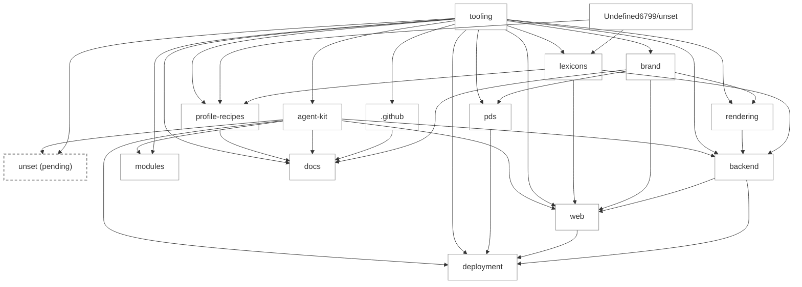

# unset.sh / Organisation map

<!-- Generated from repos.json by scripts/map.mjs. Edit repos.json, then run npm run map. -->

Find the right repository, trace its dependencies, and check what belongs there.

[Repositories](#repositories) &nbsp;·&nbsp; [Dependencies](#dependencies) &nbsp;·&nbsp; [Ownership](#repository-boundaries) &nbsp;·&nbsp; [Licences](#licences)

**15 repositories** &nbsp;·&nbsp; 14 active &nbsp;·&nbsp; 1 awaiting setup

Active means the repository exists. It does not mean its product or integration is ready.

## Repositories

Choose a repository to jump to its ownership details.

<table>
<tbody>
<tr>
<td width="440" valign="top">
<h3>The product</h3>

<a href="#repo-unset"><strong>unset</strong></a> &nbsp;Awaiting setup 
<a href="#repo-web"><strong>web</strong></a> &nbsp;Active 
<a href="#repo-backend"><strong>backend</strong></a> &nbsp;Active 
<a href="#repo-deployment"><strong>deployment</strong></a> &nbsp;Active 
<a href="#repo-modules"><strong>modules</strong></a> &nbsp;Active 
<a href="#repo-undefined6799-unset"><strong>Undefined6799/unset</strong></a> &nbsp;Active 
<a href="#repo-pds"><strong>pds</strong></a> &nbsp;Active

</td>
<td width="440" valign="top">
<h3>Look and feel</h3>

<a href="#repo-brand"><strong>brand</strong></a> &nbsp;Active 
<a href="#repo-rendering"><strong>rendering</strong></a> &nbsp;Active

</td>
</tr>
</tbody>
<tbody>
<tr>
<td width="440" valign="top">
<h3>Records and recipes</h3>

<a href="#repo-profile-recipes"><strong>profile-recipes</strong></a> &nbsp;Active 
<a href="#repo-lexicons"><strong>lexicons</strong></a> &nbsp;Active

</td>
<td width="440" valign="top">
<h3>Building unset.sh</h3>

<a href="#repo-.github"><strong>.github</strong></a> &nbsp;Active 
<a href="#repo-tooling"><strong>tooling</strong></a> &nbsp;Active 
<a href="#repo-docs"><strong>docs</strong></a> &nbsp;Active 
<a href="#repo-agent-kit"><strong>agent-kit</strong></a> &nbsp;Active

</td>
</tr>
</tbody>
</table>

## Dependencies

Arrows show recorded dependencies, including planned and conditional work. **A → B** means A supplies something B pins, copies or receives. The check refuses circular dependencies.

Dashed outlines mark repositories that have not been created.

<strong>Dependency details</strong> — pins, copies and handoffs

- `tooling` → `unset`: the shared check, branch and PR policy at full commits
- `agent-kit` → `unset`: the kit copy under .claude/, pinned by lock.json
- `backend` → `web`: planned public API consumption; browser and SSR code do not import private backend implementations
- `brand` → `web`: planned semantic tokens and assets through immutable consumer artifacts
- `lexicons` → `web`: planned supported protocol artifacts where the client needs them
- `tooling` → `web`: planned reviewed workflow callers with product-owned checks
- `agent-kit` → `web`: bootstrap instructions reference a recorded full commit; installing the kit remains pending
- `lexicons` → `backend`: planned protocol artifact consumption at reviewed immutable revisions after authority and compatibility cutover
- `rendering` → `backend`: planned rendering from authorized supplied data; no package is installed yet
- `tooling` → `backend`: planned reviewed workflow callers once meaningful product checks and builds exist
- `agent-kit` → `backend`: bootstrap instructions reference a recorded full commit; installing the kit remains pending
- `backend` → `deployment`: planned deployment of released API, indexer and other independently privileged backend images
- `web` → `deployment`: planned deployment of the released web image
- `pds` → `deployment`: planned deployment of a maintained PDS image by verified digest
- `tooling` → `deployment`: planned shared deployment mechanisms; current tooling does not implement stack deployment
- `agent-kit` → `deployment`: bootstrap instructions reference a recorded full commit; installing the kit remains pending
- `tooling` → `modules`: read-only branch-policy caller at an immutable tooling commit
- `agent-kit` → `modules`: checked copy under .claude/ at a recorded full commit, verified by CI against its lock
- `tooling` → `.github`: small read-only CI and documentation-export callers at a reviewed merged full commit; source checks must pass before export, and automatic update propagation is not configured; read-only branch-policy caller at an immutable tooling commit; staging check adoption is being rolled out separately from release and deployment
- `tooling` → `brand`: read-only branch-policy caller at an immutable tooling commit; staging check adoption is being rolled out separately from release and deployment
- `brand` → `rendering`: @unset-sh/brand at an exact version
- `tooling` → `rendering`: read-only branch-policy caller at an immutable tooling commit; staging check adoption is being rolled out separately from release and deployment
- `lexicons` → `profile-recipes`: record and object schemas copied byte-for-byte at a pinned commit
- `Undefined6799/unset` → `profile-recipes`: editor limits and consumer rendering behavior checked against a pinned app commit
- `tooling` → `profile-recipes`: read-only branch-policy caller at an immutable tooling commit; staging check adoption is being rolled out separately from release and deployment
- `brand` → `docs`: stable published @unset-sh/brand 0.1.x releases, each resolved to an immutable commit; compatible patch updates may rebuild and publish the site automatically after checks
- `.github` → `docs`: repos.json at an exact commit revision for generated organisation map and ownership views; .github remains the source of truth. Its source-owned docs/site/ maps to github/ under the reserved-name exception, with initial import tracked in docs pull request #2
- `agent-kit` → `docs`: source-owned docs/ exported to the agent-kit/ section, first export pending; adopting org-documentation through the kit sync and lock is pending
- `profile-recipes` → `docs`: source-owned docs/ exported automatically into the profile-recipes/ section with its source revision and licences; publication verified through source 1e64c46 to docs commit 2b4099f
- `tooling` → `docs`: Source-owned docs/ for the tooling/ section with an exact source revision and licences, delivered through reviewed imports; a reviewed full-commit shared refresh runs registered map generators and supplies the public workflow catalogue before site builds. Reusable workflow adoption remains explicit in each consumer; read-only branch-policy caller at an immutable tooling commit; staging check adoption is being rolled out separately from release and deployment
- `brand` → `pds`: theme colours and fonts at an exact version (after the move)
- `tooling` → `pds`: read-only branch-policy caller at an immutable tooling commit; staging check adoption is being rolled out separately from release and deployment
- `Undefined6799/unset` → `lexicons`: initial schemas copied from the merged application source at a recorded commit with per-file hashes; synchronization is manual and the proposed automatic mirror is not configured
- `tooling` → `lexicons`: read-only branch-policy caller at an immutable tooling commit; staging check adoption is being rolled out separately from release and deployment
- `tooling` → `agent-kit`: read-only branch-policy caller at an immutable tooling commit; staging check adoption is being rolled out separately from release and deployment

## Repository boundaries

Expand a repository for its full scope, ownership, current licence and where other work belongs.

### The product

<strong>unset</strong> &nbsp;<code>Approved, waiting for setup</code>

`unset-sh/unset`

The product monorepo approved by Alex on 2026-11-24 (agent-kit org-0020). One Bun workspace holding apps/web, apps/server, apps/worker and packages/* (authz, db, brand, rendering). web, backend, rendering and brand move in with their history and are archived only on Alex's word.

**Owns**

- apps/web: SvelteKit screens, SSR, web sessions and device-side integrations
- apps/server: product operations, its Elysia API groups, Better Auth, migrations and AppView
- apps/worker: every background job (indexer, authorization sync), one entry and database role per job
- packages/authz: the OpenFGA model, its tests and the may() port; packages/db, brand (still published) and rendering
- Each app's image build, pushed to ghcr.io/unset-sh/staging/<app>

**Belongs elsewhere**

- Environment topology, selected images and rollout: [`unset-sh/deployment`](https://github.com/unset-sh/deployment)
- PDS image packaging and customization: [`unset-sh/pds`](https://github.com/unset-sh/pds)
- Canonical shared protocol definitions: [`unset-sh/lexicons`](https://github.com/unset-sh/lexicons)
- Shared developer-tooling implementations: [`unset-sh/tooling`](https://github.com/unset-sh/tooling)
- Assistant rules and organisation decisions: [`unset-sh/agent-kit`](https://github.com/unset-sh/agent-kit)

**Current licence:** AGPL-3.0-only first-party work; moved packages keep their licence lines

<strong>web</strong> &nbsp;<code>Active</code>

[`unset-sh/web`](https://github.com/unset-sh/web)

The approved home for the complete web application, including messaging UI and web/device adapters. The repository exists with an initial README and licence; detailed ownership setup is under review. No runnable SvelteKit application, image or migrated feature exists yet.

**Owns**

- SvelteKit routes, SSR, screens, interactions, web sessions and web-specific response handling
- Client capability interfaces and adapters, including messaging device responsibilities where required
- Web tests, browser/server boundaries and producer image builds

**Belongs elsewhere**

- Authoritative product operations and private data adapters: [`unset-sh/backend`](https://github.com/unset-sh/backend)
- Shared brand tokens and assets: [`unset-sh/brand`](https://github.com/unset-sh/brand)
- Preview images and embeds drawn from data: [`unset-sh/rendering`](https://github.com/unset-sh/rendering)
- Canonical protocol definitions: [`unset-sh/lexicons`](https://github.com/unset-sh/lexicons)
- Environment wiring and stack delivery: [`unset-sh/deployment`](https://github.com/unset-sh/deployment)

**Current licence:** AGPL-3.0-only first-party work; foundation only, no application code imported

<strong>backend</strong> &nbsp;<code>Active</code>

[`unset-sh/backend`](https://github.com/unset-sh/backend)

The approved product backend shared by web and future mobile clients. The repository exists with an initial README and licence; detailed ownership setup is under review. Application code, API contracts, images and migration remain pending. Replaces the proposed server-kit destination; messaging is a capability here, not a standalone repository.

**Owns**

- Product domains and operations, authoritative authorization, and private domain-owned contracts
- Published service APIs and consumer compatibility checks, distinct from private domain ports
- AppView query APIs, indexing rules and feature projections; separate privileged process entry points
- Technology-specific server adapters, including AT Protocol, Postgres and S3; domain code depends on capability contracts
- Database migration definitions, image builds and runtime configuration contracts

**Belongs elsewhere**

- Web and messaging screens, browser sessions and device-side integrations: [`unset-sh/web`](https://github.com/unset-sh/web)
- Environment topology, bucket provisioning, selected images and stack rollout: [`unset-sh/deployment`](https://github.com/unset-sh/deployment)
- PDS image packaging and customization: [`unset-sh/pds`](https://github.com/unset-sh/pds)
- Canonical shared protocol definitions: [`unset-sh/lexicons`](https://github.com/unset-sh/lexicons)
- Shared developer-tooling implementations: [`unset-sh/tooling`](https://github.com/unset-sh/tooling)

**Current licence:** AGPL-3.0-only first-party work; foundation only, no application code imported

<strong>deployment</strong> &nbsp;<code>Active</code>

[`unset-sh/deployment`](https://github.com/unset-sh/deployment)

The approved home for environment definitions and stack release assembly. The repository exists with an initial README and licence; detailed ownership setup is under review. No deployable stack, image selections, infrastructure configuration or rollout automation exists yet.

**Owns**

- Environment topology, networks, volumes, bucket provisioning, configuration references and access policies
- A versioned compatible set of producer-built immutable images and artifacts, not one combined services image
- Rollout order, health verification, recorded deployed versions and recovery procedures
- Execution of producer-owned migration contracts and separately operated services such as PDS and Tap when adopted

**Belongs elsewhere**

- Application code, AppView/indexer behavior and database migration definitions: [`unset-sh/backend`](https://github.com/unset-sh/backend)
- Web code and web image builds: [`unset-sh/web`](https://github.com/unset-sh/web)
- Maintained PDS image builds and customization: [`unset-sh/pds`](https://github.com/unset-sh/pds)
- Reusable CI and deployment execution mechanisms: [`unset-sh/tooling`](https://github.com/unset-sh/tooling)

**Current licence:** AGPL-3.0-only first-party work; foundation only, no application code imported

<strong>modules</strong> &nbsp;<code>Active</code>

[`unset-sh/modules`](https://github.com/unset-sh/modules)

The approved home for marketplace modules: small apps a member turns on or off, built here and reviewed by unset before members see them. The repository exists as a foundation only (README, licence, agent rules, CI); no contract, module, list or marketplace exists yet. The owner set the direction (one repository first, every module reviewed, a sandboxed web app given a screen inside unset.sh); the licence for outside work and the remaining design decisions are open, and outside contributions are not accepted yet.

**Owns**

- The module contract: the manifest, the permissions a module may ask for and the messages between a module and unset.sh; not designed yet
- The starter module, the modules themselves and their own record types
- The generated list of accepted modules and the block list
- The checks every module must pass and the developer guide

**Belongs elsewhere**

- Loading a module, showing its screen and the marketplace screens: [`unset-sh/web`](https://github.com/unset-sh/web)
- A member's on or off state and every write made for a module: [`unset-sh/backend`](https://github.com/unset-sh/backend)
- The sh.unset.* record types: [`unset-sh/lexicons`](https://github.com/unset-sh/lexicons)
- Serving module files and their domain: [`unset-sh/deployment`](https://github.com/unset-sh/deployment)
- Colours, fonts and icons: [`unset-sh/brand`](https://github.com/unset-sh/brand)

**Current licence:** AGPL-3.0-only first-party work; foundation only. The licence for the contract, the starter module and outside developers' modules is not set

<strong>Undefined6799/unset</strong> &nbsp;<code>Active</code>

[`Undefined6799/unset`](https://github.com/Undefined6799/unset)

The existing application outside the organisation, retained read-only during the migration. Its implementation and regression evidence inform the new web, backend and deployment repositories; their creation does not mean the application has moved.

**Owns**

- The current application implementation and its tests until each destination migration is verified
- Historical application decisions and recorded schema-import provenance
- Existing runtime behavior; no production cutover is implied by the organisation layout

**Belongs elsewhere**

- New organisation web UI, routes and web-specific adapters: [`unset-sh/web`](https://github.com/unset-sh/web)
- New organisation product operations, AppView and server adapters: [`unset-sh/backend`](https://github.com/unset-sh/backend)
- New environment topology and stack release assembly: [`unset-sh/deployment`](https://github.com/unset-sh/deployment)
- Canonical shared brand and rendering capabilities: [`unset-sh/brand`](https://github.com/unset-sh/brand) and rendering
- Organisation architecture decisions and this migration record: [`unset-sh/agent-kit`](https://github.com/unset-sh/agent-kit)

**Current licence:** AGPL-3.0-only; the lexicon schemas are MIT (as the rule wants); shared/ is MIT under ADR 0012

<strong>pds</strong> &nbsp;<code>Active</code>

[`unset-sh/pds`](https://github.com/unset-sh/pds)

The home for unset.sh's PDS image and everything that customises the PDS: the build on top of the official image, the theme for its sign-in and account pages, and their pins. Empty for now; until it moves, the image is built in the app repository (deployment/pds/).

**Owns**

- The first-party PDS image: built on the official bluesky-social/pds image, with its upstream source and package versions pinned
- Customising the PDS: the theme for its sign-in and account pages, and any other change to the stock PDS

**Belongs elsewhere**

- PDS runtime topology, volumes and deployed image selection: [`unset-sh/deployment`](https://github.com/unset-sh/deployment)
- The privileged pds-admin process and application integration: [`unset-sh/backend`](https://github.com/unset-sh/backend)
- Shared colours, fonts and the mark: [`unset-sh/brand`](https://github.com/unset-sh/brand)

**Current licence:** AGPL-3.0-only first-party work (pds#3); the official PDS it builds on keeps its own licence

### Look and feel

<strong>brand</strong> &nbsp;<code>Active</code>

[`unset-sh/brand`](https://github.com/unset-sh/brand)

The editable visual contract for unset.sh. Ships static CSS, JSON, fonts, mark and icon data as @unset-sh/brand on GitHub Packages, and builds its Hugo guide with an interactive Svelte component gallery for GitHub Pages.

**Owns**

- The editable brand contract: semantic colour, typography, spacing and component style roles
- Generated static package exports, optional Tailwind/shadcn style adapters, fonts, the mark and pinned icon data
- Asset provenance and licences; historical design-sheet provenance is retained
- Brand usage guidelines, the Hugo brand guide and its private interactive Svelte component gallery
- Changeset version preparation, package validation and protected publication, and GitHub Pages guide deployment

**Belongs elsewhere**

- Anything drawn from data, such as link previews and share cards: [`unset-sh/rendering`](https://github.com/unset-sh/rendering)
- Business rules, authentication, network calls and application state: [`unset-sh/backend`](https://github.com/unset-sh/backend) or web, according to the capability
- Component interaction behaviour or consumer deployment orchestration: the consuming application and its shadcn-svelte/Bits UI integration

**Current licence:** AGPL-3.0-only project files; OFL-1.1 fonts, reserved Unset mark/app assets, and MIT Tabler/upstream component notices are preserved

<strong>rendering</strong> &nbsp;<code>Active</code>

[`unset-sh/rendering`](https://github.com/unset-sh/rendering)

Templates and the one rendering path for preview images and embeds, with a gallery of hard cases. Ships @unset-sh/rendering on GitHub Packages; no running service.

**Owns**

- Templates for profile, post and article previews, one owner per template
- Rendering supplied data into images and embeds
- The gallery of hard cases each template must survive

**Belongs elsewhere**

- Deciding what to show: data, visibility, URLs, caching, removal: [`unset-sh/backend`](https://github.com/unset-sh/backend) (after the application migration; currently the read-only source app)
- Colours, fonts and the mark: [`unset-sh/brand`](https://github.com/unset-sh/brand)
- A server or a queue that renders on request: [`unset-sh/backend`](https://github.com/unset-sh/backend) (after the application migration; currently the read-only source app)

**Current licence:** AGPL-3.0-only; third-party dependencies retain their own licences

### Records and recipes

<strong>profile-recipes</strong> &nbsp;<code>Active</code>

[`unset-sh/profile-recipes`](https://github.com/unset-sh/profile-recipes)

Persona profile layouts (recipes) with a guide an AI assistant follows to build someone's profile, plus sample records checked against the lexicons.

**Owns**

- Recipes: recipe.json, GUIDE.md, sample records, assets and preview per persona
- AGENTS.md: the rules an assistant follows when applying a recipe
- The validator that checks recipes against a vendored lexicon snapshot and editor limits
- Human documentation in docs/ and its source-owned export into docs:profile-recipes/; automated publication verified through source 1e64c46 to docs commit 2b4099f

**Belongs elsewhere**

- The lexicon schemas themselves (schemas/upstream/ here is a copy): [`unset-sh/lexicons`](https://github.com/unset-sh/lexicons)
- The profile editor and its limits (limits.json here is a mirror): [`Undefined6799/unset`](https://github.com/Undefined6799/unset)
- The documentation site's root configuration, navigation and layouts: [`unset-sh/docs`](https://github.com/unset-sh/docs)
- Shared CI, release, deployment and documentation-export implementations, supporting scripts and tests: [`unset-sh/tooling`](https://github.com/unset-sh/tooling)
- Organisation community defaults and native starter workflow templates: [`unset-sh/.github`](https://github.com/unset-sh/.github)

**Current licence:** Tooling AGPL-3.0-only; recipes CC0-1.0; copied schemas retain their upstream MIT notice and local fonts retain their SIL Open Font Licences

<strong>lexicons</strong> &nbsp;<code>Active</code>

[`unset-sh/lexicons`](https://github.com/unset-sh/lexicons)

The public MIT-licensed sh.unset.* schemas, reference documentation and examples, and the agreed destination for protocol authority. Current schema bytes retain their exact application-import provenance; the maintained import/authoring policy and consumer adoption still need the authority cutover. GitHub source, generated SDKs and DNS/PDS publication are separate states.

**Owns**

- The published copy of the sh.unset.* schemas, their docs and examples
- The agreed destination for protocol authority and compatible evolution; implementation of the authoring-policy cutover remains pending

**Belongs elsewhere**

- Any edit to a schema: [`Undefined6799/unset`](https://github.com/Undefined6799/unset) (shared/lexicons/schemas/); coordinate changes there and refresh the recorded snapshot manually

**Current licence:** MIT schemas and documentation

### Building unset.sh

<strong>.github</strong> &nbsp;<code>Active</code>

[`unset-sh/.github`](https://github.com/unset-sh/.github)

The organisation's front page, repository map, community defaults and native starter workflow catalogue. Local map validation stays here, with small pinned read-only callers for shared checks and documentation export from tooling. Consumers retain their own workflow events, permissions and project commands.

**Owns**

- The organisation profile page (profile/README.md)
- This map: repos.json, MAP.md and the daily check that compares them with GitHub
- Organisation community defaults: contribution, conduct, security, support and accessibility policies; public and private report forms and a general pull-request template
- Native starter workflow templates in workflow-templates/, local metadata validation and small callers with explicit events, permissions, inputs and reviewed tooling pins
- Human guidance for organisation defaults and starter templates in docs/site/, plus a pointer to tooling's maintained publishing-key guide; exports use the reserved-name mapping docs:github/, with initial delivery tracked in docs pull request #2

**Belongs elsewhere**

- Code, docs or assets of any product: the repository that owns them, from this map
- Shared CI, release, deployment and documentation-export implementations, supporting scripts and tests: [`unset-sh/tooling`](https://github.com/unset-sh/tooling)
- A consuming repository's build and test commands, event triggers and small workflow callers: the consuming repository; migration to central implementations is pending
- AI working notes and supporting artifacts: [`unset-sh/agent-kit`](https://github.com/unset-sh/agent-kit) under notes/ and artifacts/, outside the distributed kit

**Current licence:** AGPL-3.0-only

<strong>tooling</strong> &nbsp;<code>Active</code>

[`unset-sh/tooling`](https://github.com/unset-sh/tooling)

Maintains shared CI, protected-release and documentation-export implementations, supporting scripts and tests. The initial implementation is merged through pull request #1 at version 0.0.0; the first release and broader consumer adoption remain pending. Consumers retain their own events, permissions, inputs, build and test logic, and immutable caller pins.

**Owns**

- Shared CI, protected-release and documentation-export implementations, supporting scripts and tests; Pages and deployment implementations have not been centralised yet
- Flat reusable entry points directly in .github/workflows/; shared sources under workflows/shared/ and repository-specific sources under workflows/<repository>/ organise the implementation without changing the native GitHub location
- Versioned tooling releases and the implementation of dependency-update proposals; automatic adoption requires explicit update PRs, checks, approvals, eligible auto-merge and downstream delivery, and is not configured yet. Owner release approvals remain required
- Maintained human tooling guides and workflow contracts in docs/ for the docs:tooling/ section; initial delivery is tracked in docs pull request #5
- Read-only public workflow discovery, digest-bound descriptions and immutable reusable-call resolution for the documentation workflow catalogue; shared refresh orchestration for registered map generators

**Belongs elsewhere**

- The organisation profile, repository map, community defaults and native starter workflow templates: [`unset-sh/.github`](https://github.com/unset-sh/.github)
- A consumer's events, permissions, inputs, build and test commands, product code and pinned workflow callers: the consuming repository
- The documentation site framework and publication configuration: [`unset-sh/docs`](https://github.com/unset-sh/docs)
- AI working notes, supporting artifacts, shared assistant rules and organisation decision records: [`unset-sh/agent-kit`](https://github.com/unset-sh/agent-kit)

**Current licence:** AGPL-3.0-only

<strong>docs</strong> &nbsp;<code>Active</code>

[`unset-sh/docs`](https://github.com/unset-sh/docs)

The live organisation-only docs.unset.sh site: a root Hugo framework edited by pull requests, source-owned repository sections and map views derived from .github. Profile-recipes publishes its section automatically. The old app mirror workflow and its writable credential are retired; the site excludes app documentation until the app moves into the organisation.

**Owns**

- The root Hugo configuration, theme integration, layouts, navigation, front page and publication framework, changed by pull request
- Source-derived organisation map and ownership views from an exact .github revision
- Map-specific validation, accessible organisation and workflow views, and a map registry whose generators run through the pinned shared refresh during site publication; workflow collection and shared orchestration are implemented in tooling
- One top folder per participating unset-sh repository; mirrored pages, examples and diagrams remain source-owned and are replaced only by that repository's docs job
- The site build commands, checks and GitHub Pages publication for docs.unset.sh; migration to central workflow implementations and reviewed callers is pending

**Belongs elsewhere**

- Authoring or hand-editing a source repository's mirrored documentation: the source repository's docs folder
- Hand-maintaining repository ownership descriptions: [`unset-sh/.github`](https://github.com/unset-sh/.github) repos.json
- Shared visual values, assets and the brand contract: [`unset-sh/brand`](https://github.com/unset-sh/brand)
- The shared human documentation standard and authoring templates: [`unset-sh/agent-kit`](https://github.com/unset-sh/agent-kit) (the org-documentation skill)
- AI working notes and supporting artifacts: [`unset-sh/agent-kit`](https://github.com/unset-sh/agent-kit) under notes/ and artifacts/, outside the distributed kit
- Shared CI, release, deployment and documentation-export implementations, supporting scripts and tests: [`unset-sh/tooling`](https://github.com/unset-sh/tooling)
- Organisation community defaults and native starter workflow templates: [`unset-sh/.github`](https://github.com/unset-sh/.github)
- Application documentation from outside the unset-sh organisation: its source repository; the app is only context in the organisation map

**Current licence:** AGPL-3.0-only root framework; mirrored source documentation and third-party assets retain their own licences

<strong>agent-kit</strong> &nbsp;<code>Active</code>

[`unset-sh/agent-kit`](https://github.com/unset-sh/agent-kit)

The rules, skills and templates every repository's assistant needs. Repositories copy them under .claude/ from one reviewed commit of main, pinned by a lock file; the kit has no releases (org-0010). Organisation decision records, AI working notes and artifacts are kept here, outside the distributed kit.

**Owns**

- Organisation-wide assistant rules and the three generic engineering documents
- The shared human documentation standard, architecture guidance and authoring templates as the org-documentation skill
- Organisation decision records, including the accepted tooling and documentation ownership decisions
- AI working notes in notes/ and supporting artifacts in artifacts/, grouped by task and excluded from the distributed kit
- The CLAUDE.md and AGENTS.md templates
- Shared skills and subagents, the model and effort router text, and the sync script
- Experience reviews through the org-experience-review skill: seven perspectives as prompts inside the skill, not separate subagents
- Its own human guides in docs/, exported to the docs site's agent-kit/ section; first export pending
- Requester/provider procedures for missing brand resources, with requests tracked as brand issues; AGENTS.md entry-point templates route agents to the shared rules and skills

**Belongs elsewhere**

- A repository's own rules: that repository's CLAUDE.md
- The organisation map: [`unset-sh/.github`](https://github.com/unset-sh/.github)
- A repository's own architecture decision records: the repository that owns the decision
- Another repository's maintained human documentation: the source repository's docs/; exported to docs for publication
- Shared CI, release, deployment and documentation-export implementations, supporting scripts and tests: [`unset-sh/tooling`](https://github.com/unset-sh/tooling)
- Organisation community defaults and native starter workflow templates: [`unset-sh/.github`](https://github.com/unset-sh/.github)

**Current licence:** AGPL-3.0-only

## Licences

Licence is set per repository (Alex, 2026-11-21). Product repositories are AGPL-3.0-only and take no outside code for now. Work meant to be copied stays permissive: the profile-recipes recipes are CC0-1.0 and the lexicon schemas are MIT, and those two take outside work with a DCO sign-off only. Third-party work keeps its own licence. There is no contributor agreement.

**1 repositories do not match the rule yet.** Changing a published licence needs the owner's decision.

| Repository | Licence today |
| --- | --- |
| [Undefined6799/unset](#repo-undefined6799-unset) | AGPL-3.0-only; the lexicon schemas are MIT (as the rule wants); shared/ is MIT under ADR 0012 |

---

Maintaining this map

Read this map before starting work in any unset.sh repository. Update [`repos.json`](repos.json) in the same change that creates, renames, archives or changes the scope of a repository, then run `npm run map`.

A daily check compares this map with GitHub and opens an issue when they differ.

