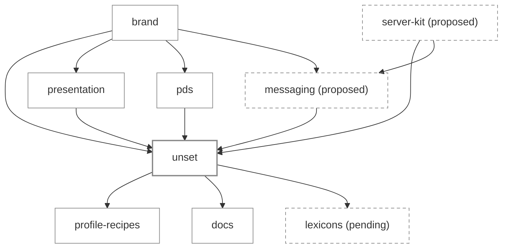

# unset.sh / Organisation map

<!-- Generated from repos.json by scripts/map.mjs. Edit repos.json, then run npm run map. -->

Find the right repository, trace its dependencies, and check what belongs there.

[Repositories](#repositories) &nbsp;·&nbsp; [Dependencies](#dependencies) &nbsp;·&nbsp; [Ownership](#repository-boundaries) &nbsp;·&nbsp; [Licences](#licences)

**11 repositories** &nbsp;·&nbsp; 8 active &nbsp;·&nbsp; 1 awaiting setup &nbsp;·&nbsp; 2 proposed

Active means the repository exists. It does not mean its product or integration is ready.

## Repositories

Choose a repository to jump to its ownership details.

<table>
<tbody>
<tr>
<td width="440" valign="top">
<h3>The product</h3>

<a href="#repo-unset"><strong>unset</strong></a> &nbsp;Active 
<a href="#repo-pds"><strong>pds</strong></a> &nbsp;Active 
<a href="#repo-messaging"><strong>messaging</strong></a> &nbsp;Proposed, not approved

</td>
<td width="440" valign="top">
<h3>Look and feel</h3>

<a href="#repo-brand"><strong>brand</strong></a> &nbsp;Active 
<a href="#repo-presentation"><strong>presentation</strong></a> &nbsp;Active

</td>
</tr>
</tbody>
<tbody>
<tr>
<td width="440" valign="top">
<h3>Records and recipes</h3>

<a href="#repo-profile-recipes"><strong>profile-recipes</strong></a> &nbsp;Active 
<a href="#repo-lexicons"><strong>lexicons</strong></a> &nbsp;Approved, waiting for setup

</td>
<td width="440" valign="top">
<h3>Building unset.sh</h3>

<a href="#repo-.github"><strong>.github</strong></a> &nbsp;Active 
<a href="#repo-docs"><strong>docs</strong></a> &nbsp;Active 
<a href="#repo-server-kit"><strong>server-kit</strong></a> &nbsp;Proposed, not approved 
<a href="#repo-agent-kit"><strong>agent-kit</strong></a> &nbsp;Active

</td>
</tr>
</tbody>
</table>

## Dependencies

Arrows show recorded dependencies, including planned and conditional work. **A → B** means A supplies something B pins, copies or receives. The check refuses circular dependencies.

Dashed outlines mark repositories that have not been created.

No dependency edges recorded: [.github](#repo-.github) · [agent-kit](#repo-agent-kit).

<strong>Dependency details</strong> — pins, copies and handoffs

- `brand` → `unset`: @unset-sh/brand at an exact version (after the rewrite)
- `presentation` → `unset`: @unset-sh/presentation at an exact version (after the rewrite)
- `messaging` → `unset`: @unset-sh/messaging-contract at an exact version (planned)
- `server-kit` → `unset`: pinned release (if approved)
- `pds` → `unset`: the PDS image by pinned digest (after the move)
- `brand` → `presentation`: @unset-sh/brand at an exact version
- `unset` → `profile-recipes`: lexicon schemas and editor limits, copied at a pinned commit
- `unset` → `docs`: pushes docs/human and docs/site into unset/ with its own deploy key
- `brand` → `pds`: theme colours and fonts at an exact version (after the move)
- `unset` → `lexicons`: pushes the schemas with its own deploy key
- `brand` → `messaging`: @unset-sh/brand at an exact version
- `server-kit` → `messaging`: pinned kit packages (if server-kit is approved)

## Repository boundaries

Expand a repository for its full scope, ownership, current licence and where other work belongs.

### The product

<strong>unset</strong> &nbsp;<code>Active</code>

[`Undefined6799/unset`](https://github.com/Undefined6799/unset)

The unset.sh app: web, admin, public API, indexer, media proxy, their database and deployment. Lives outside the organisation for now and will be largely rewritten, then wired to the repositories below by pinned releases.

**Owns**

- Every product rule and screen of unset.sh, and the data behind them
- The sh.unset.* lexicon schemas (shared/lexicons/schemas/), the source of truth until the organisation takes it over
- Deciding what to present: which data, who may see it, URLs, caching and removal
- The app's architecture decision records (docs/human/decisions/)

**Belongs elsewhere**

- Design tokens, fonts, the mark and icons: [`unset-sh/brand`](https://github.com/unset-sh/brand)
- Preview images and embeds drawn from data: [`unset-sh/presentation`](https://github.com/unset-sh/presentation)
- Ready-made profile layouts for AI-assisted setup: [`unset-sh/profile-recipes`](https://github.com/unset-sh/profile-recipes)
- The chat app (unset.cc), once it moves: `unset-sh/messaging`
- The PDS image and its customisation, once they move: [`unset-sh/pds`](https://github.com/unset-sh/pds)

**Current licence:** AGPL-3.0-only; the lexicon schemas are MIT (as the rule wants); shared/ is MIT under ADR 0012

<strong>pds</strong> &nbsp;<code>Active</code>

[`unset-sh/pds`](https://github.com/unset-sh/pds)

The home for unset.sh's PDS image and everything that customises the PDS: the build on top of the official image, the theme for its sign-in and account pages, and their pins. Empty for now; until it moves, the image is built in the app repository (deployment/pds/).

**Owns**

- The first-party PDS image: built on the official bluesky-social/pds image, with its upstream source and package versions pinned
- Customising the PDS: the theme for its sign-in and account pages, and any other change to the stock PDS

**Belongs elsewhere**

- Running and deploying the PDS, and the process that holds its admin password (pds-admin): [`Undefined6799/unset`](https://github.com/Undefined6799/unset)
- Colours, fonts and the mark the theme uses: [`unset-sh/brand`](https://github.com/unset-sh/brand)

**Current licence:** None yet; should be AGPL-3.0-only. The official PDS it builds on keeps its own licence

<strong>messaging</strong> &nbsp;<code>Proposed, not approved</code>

`unset-sh/messaging`

The private messaging product on unset.cc: one-to-one chat on Matrix today, later communities, channels, roles and voice. Plan drafted, awaiting approval; not created.

**Owns**

- The chat client and the door (the public process on unset.cc)
- The admin service that alone holds the MAS credential
- Messaging rules, the Matrix adapter and the Synapse policy module
- The Synapse image and the reviewed Synapse and MAS configs
- Its own database tables
- @unset-sh/messaging-contract: the only thing the app pins

**Belongs elsewhere**

- Identity and sign-in: [`Undefined6799/unset`](https://github.com/Undefined6799/unset)
- Generic server code (HTTP kit, CSRF gate, egress guard, sealing): `unset-sh/server-kit`
- Design tokens, fonts and icons: [`unset-sh/brand`](https://github.com/unset-sh/brand)
- Deploying the whole stack: [`Undefined6799/unset`](https://github.com/Undefined6799/unset) (until a deploy repository is decided)

**Current licence:** Not created; AGPL-3.0-only

### Look and feel

<strong>brand</strong> &nbsp;<code>Active</code>

[`unset-sh/brand`](https://github.com/unset-sh/brand)

Fixed files that say what unset.sh looks like, as pinned copies of the design sheet. Ships the package @unset-sh/brand (data only) on GitHub Packages.

**Owns**

- Design tokens (colour, type, spacing), the two fonts, the mark and icons
- Brand guidelines: how to use colour, type and the mark
- source.json: the design sheet version and sha256 of every copied file

**Belongs elsewhere**

- Anything drawn from data, such as link previews and share cards: [`unset-sh/presentation`](https://github.com/unset-sh/presentation)
- Code that decides or serves anything: [`Undefined6799/unset`](https://github.com/Undefined6799/unset)
- A file that is not in the design sheet yet: the design sheet first

**Current licence:** Not decided; waits for the branding pass. The fonts are third-party (OFL-1.1)

<strong>presentation</strong> &nbsp;<code>Active</code>

[`unset-sh/presentation`](https://github.com/unset-sh/presentation)

Templates and the one rendering path for preview images and embeds, with a gallery of hard cases. Ships @unset-sh/presentation on GitHub Packages; no running service.

**Owns**

- Templates for profile, post and article previews, one owner per template
- Rendering supplied data into images and embeds
- The gallery of hard cases each template must survive

**Belongs elsewhere**

- Deciding what to show: data, visibility, URLs, caching, removal: [`Undefined6799/unset`](https://github.com/Undefined6799/unset)
- Colours, fonts and the mark: [`unset-sh/brand`](https://github.com/unset-sh/brand)
- A server or a queue that renders on request: [`Undefined6799/unset`](https://github.com/Undefined6799/unset) (it calls this package)

**Current licence:** None yet; should be AGPL-3.0-only

### Records and recipes

<strong>profile-recipes</strong> &nbsp;<code>Active</code>

[`unset-sh/profile-recipes`](https://github.com/unset-sh/profile-recipes)

Persona profile layouts (recipes) with a guide an AI assistant follows to build someone's profile, plus sample records checked against the lexicons.

**Owns**

- Recipes: recipe.json, GUIDE.md, sample records, assets and preview per persona
- AGENTS.md: the rules an assistant follows when applying a recipe
- The validator that checks recipes against a vendored lexicon snapshot and editor limits

**Belongs elsewhere**

- The lexicon schemas themselves (lexicons/ here is a copy): [`Undefined6799/unset`](https://github.com/Undefined6799/unset)
- The profile editor and its limits (limits.json here is a mirror): [`Undefined6799/unset`](https://github.com/Undefined6799/unset)

**Current licence:** Recipes CC0-1.0 (as the rule wants); tooling MIT, to move to AGPL-3.0-only

<strong>lexicons</strong> &nbsp;<code>Approved, waiting for setup</code>

`unset-sh/lexicons`

A one-way, read-only copy of the sh.unset.* lexicon schemas, pushed by the app's mirror job. Waiting for setup by the owner; the direction reverses later, when the organisation becomes the source of truth.

**Owns**

- The published copy of the sh.unset.* schemas, their docs and examples

**Belongs elsewhere**

- Any edit to a schema: [`Undefined6799/unset`](https://github.com/Undefined6799/unset) (shared/lexicons/schemas/); the mirror copies it here

**Current licence:** Not created; MIT, copied from the app

### Building unset.sh

<strong>.github</strong> &nbsp;<code>Active</code>

[`unset-sh/.github`](https://github.com/unset-sh/.github)

The organisation's front page and this map.

**Owns**

- The organisation profile page (profile/README.md)
- This map: repos.json, MAP.md and the daily check that compares them with GitHub
- Community health files shared by every repository, when they are added

**Belongs elsewhere**

- Code, docs or assets of any product: the repository that owns them, from this map

**Current licence:** AGPL-3.0-only

<strong>docs</strong> &nbsp;<code>Active</code>

[`unset-sh/docs`](https://github.com/unset-sh/docs)

Every repository's human docs, aggregated, and the docs.unset.sh site built from them on GitHub Pages. Nothing here is written by hand: each source repository's CI pushes its own top folder. Waiting for its first push.

**Owns**

- One top folder per source repository, replaced only by that repository's docs job
- The site build and GitHub Pages deploy for docs.unset.sh

**Belongs elsewhere**

- Writing or editing docs: the source repository's docs folder

**Current licence:** None yet; holds copies of other repositories' docs, which keep their source's licence

<strong>server-kit</strong> &nbsp;<code>Proposed, not approved</code>

`unset-sh/server-kit`

Proposed: the generic security code the app and messaging both need (HTTP kit and CSRF gate, egress guard, sealed storage, signed admin envelope, config, log). Not approved yet.

**Owns**

- Generic server code with no product meaning

**Belongs elsewhere**

- Anything with product meaning: [`Undefined6799/unset`](https://github.com/Undefined6799/unset) or messaging

**Current licence:** Not created; AGPL-3.0-only for the whole kit

<strong>agent-kit</strong> &nbsp;<code>Active</code>

[`unset-sh/agent-kit`](https://github.com/unset-sh/agent-kit)

The rules, skills and templates every repository's assistant needs, released as one version and copied into each repository under .claude/, pinned by a lock file.

**Owns**

- Organisation-wide assistant rules and the three generic engineering documents
- The CLAUDE.md and AGENTS.md templates
- Shared skills and subagents, the model and effort router text, and the sync script

**Belongs elsewhere**

- A repository's own rules: that repository's CLAUDE.md
- The organisation map: [`unset-sh/.github`](https://github.com/unset-sh/.github)
- Decision records: the organisation's decision records

**Current licence:** None on main yet; AGPL-3.0-only in the first release pull request

## Licences

Licence is set per repository (Alex, 2026-11-21). Product repositories are AGPL-3.0-only and take no outside code for now. Work meant to be copied stays permissive: the profile-recipes recipes are CC0-1.0 and the lexicon schemas are MIT, and those two take outside work with a DCO sign-off only. Third-party work keeps its own licence. There is no contributor agreement.

**7 repositories do not match the rule yet.** Changing a published licence needs the owner's decision.

| Repository | Licence today |
| --- | --- |
| [unset](#repo-unset) | AGPL-3.0-only; the lexicon schemas are MIT (as the rule wants); shared/ is MIT under ADR 0012 |
| [brand](#repo-brand) | Not decided; waits for the branding pass. The fonts are third-party (OFL-1.1) |
| [presentation](#repo-presentation) | None yet; should be AGPL-3.0-only |
| [profile-recipes](#repo-profile-recipes) | Recipes CC0-1.0 (as the rule wants); tooling MIT, to move to AGPL-3.0-only |
| [docs](#repo-docs) | None yet; holds copies of other repositories' docs, which keep their source's licence |
| [pds](#repo-pds) | None yet; should be AGPL-3.0-only. The official PDS it builds on keeps its own licence |
| [agent-kit](#repo-agent-kit) | None on main yet; AGPL-3.0-only in the first release pull request |

---

Maintaining this map

Read this map before starting work in any unset.sh repository. Update [`repos.json`](repos.json) in the same change that creates, renames, archives or changes the scope of a repository, then run `npm run map`.

A daily check compares this map with GitHub and opens an issue when they differ.

